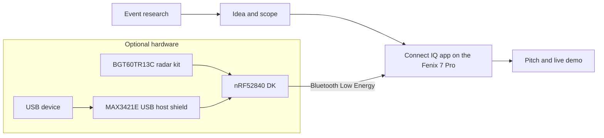

# MAP: workstreams and how they connect

> A router, not a file listing. One row per workstream, each pointing to the entry point that owns
> the detail. If a row and its folder disagree, the folder wins: fix the row, then add a line to the
> ledger in `START_HERE.md`.

## 0. Workstreams

| Workstream | Entry point | State | Your open action |
|---|---|---|---|
| FocusPeak: watch app, watch face, backend, phone page (the deliverable) | `main_project/README.md`, then `main_project/DECISIONS.md` | ✅ Tag `v5`, tests pass in the simulator | Check each screen on the real watch |
| Connect IQ toolchain and signing key | `CLAUDE.md` (verified commands), `test_project/developer_key` | ✅ Builds for `fenix7pro` pass | None |
| Event research | `research/` | ⚠️ In progress | Read the briefing when it is ready |
| nRF52840 development kit (DK) and its Zephyr workspace | `hardware/nrf52840-dk/FINDINGS.md`, then `hardware/nrf52840-dk/eie_nrf52840/README.md` | ⚠️ In progress | Install SEGGER J-Link and nrfutil |
| MAX3421E Universal Serial Bus (USB) host shield | `hardware/max3421e-usb-host-shield/FINDINGS.md` | ⚠️ In progress | Identify the maker and revision of the shield |
| BGT60TR13C 60 GHz radar kit | `hardware/bgt60tr13c/FINDINGS.md` | ⚠️ In progress | Confirm the kit name on the boards |
| Hardware bring-up: radar to laptop to DK to watch | `prep_tests/RESULTS.md` | ✅ Works live (reference only, not app code) | None |
| Pitch | `pitch/` (made at the event) and the `presentation` skill | ✅ Deck tools ready and tested | None before the event |
| Project skills | `.claude/skills/` (table in `CLAUDE.md`) | ✅ Ready | None |
| Vendor SDK Manager | `connectiq-sdk-manager-windows/` | Reference only | None |

Root files that are not workstreams: `CLAUDE.md` (rules and commands), `START_HERE.md` (session
bootstrap and ledger), and this file.

## 1. How the workstreams connect

The research feeds the idea, the idea becomes the app, and the app is the demo of the pitch. The
boards are optional. They can feed data to the watch, and the `FINDINGS.md` of each board holds the
verified facts and the verdict on each path.



```
Event research -> Idea and scope -> Connect IQ app (Fenix 7 Pro) -> Pitch and live demo
                                          ^
                                          | Bluetooth Low Energy (optional)
BGT60TR13C radar kit ------------> nRF52840 DK
USB device -> MAX3421E USB host shield -^
```

## 2. Folder rules

| Folder | Rule |
|---|---|
| `main_project/` | The one app of the team. `DECISIONS.md` holds one dated line per decision |
| `pitch/` | The deck, `talk_notes.md`, `qa.md`, the fallback video. New versions as `_v2`, `_v3`, never overwrite |
| `research/` | Findings with a source on every line. The briefing for the team |
| `hardware/<board>/docs/` | Vendor documents as downloaded. Do not edit them |
| `hardware/<board>/code/` and `hardware/nrf52840-dk/eie_nrf52840/` | Cloned repos for reference. Copy code into the project before you change it |
| `.claude/skills/` | Project skills. Change a skill only on an instruction of the user |

## 3. Maintenance

| Event | Action |
|---|---|
| A workstream starts, stops or moves its entry point | Update its row here, then add a ledger line in `START_HERE.md` |
| A file inside a workstream changes | Nothing here: the entry point of that workstream owns the detail |
| A row and its folder disagree | The folder wins. Fix the row |
