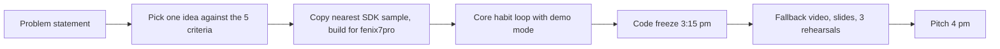

# START HERE: session bootstrap

> Read this file first in every new session. It holds the read order, the current state with open
> actions, the event facts, the house rules and the change-sync ledger of the hackathon workspace.

## 0. Status on 2026-11-13 (the day before the event)

| Area | State | Your open action |
|---|---|---|
| Connect IQ toolchain | ✅ Software development kit (SDK) 9.1.0, `fenix7pro` device files and the developer key work. Sample builds pass in about 5 s | None |
| The app (`main_project/`) | ✅ FocusPeak, tag `v5`: watch app, watch face, local backend, phone page. State and run steps in `main_project/README.md` | Check each screen on the real watch. Then start the pitch |
| Event research | ✅ `research/hackathon/findings.md`, `research/radar_datasets/findings.md` | Read both before the event |
| nRF52840 development kit (DK) | ✅ Zephyr builds, J-Link flashing works, Bluetooth bridge firmware runs | None |
| MAX3421E Universal Serial Bus (USB) host shield | ⚠️ Not used. A 5 V build must not be stacked on the DK | Read the maker name and revision on the shield |
| BGT60TR13C radar kit | ✅ DEMO kit confirmed. Radar → laptop → DK → Bluetooth → Forerunner 265 works live (`prep_tests/`) | None |
| Pitch | ✅ Skill and deck tools ready and tested | None before the event |
| Project skills | ✅ 5 skills in `.claude/skills/`, adapted to this project | None |

## 1. Instruction to Claude

Before you answer the first task, read the files in section 2 in order. Then give a 3 to 5 line
orientation:

1. The phase: before the event, or the event hour (see section 5).
2. The problem statement, when the team has it (`main_project/DECISIONS.md` holds it once the event starts).
3. The top open action from section 0 or from `DECISIONS.md`.
4. One clarifying question, only if the task is ambiguous.

Do not produce artefacts (code, slides, reports) before the read-and-orient step.

## 2. Required reads, in order

| # | File | Why | When |
|---|---|---|---|
| 1 | `CLAUDE.md` | Event rules, toolchain, verified commands, skills | Always |
| 2 | `MAP.md` | Where each workstream lives and how the parts connect | Always |
| 3 | `main_project/DECISIONS.md` | Problem statement, chosen idea, decisions made at the event | Once it exists |
| 4 | `research/` (the briefing and `hackathon/findings.md`) | Judging, earlier events, likely themes, Connect IQ limits | Idea, scope or pitch work |
| 5 | `hardware/<board>/FINDINGS.md` | Set-up, wiring, limits, open questions of one board | Before any hardware work |
| 6 | The skill for the task (section 3) | The rules for that kind of output | Before the first edit |

## 3. Skills: which one for which task

| Task | Skill |
|---|---|
| Any code: Monkey C, Zephyr C, Python | `hackathon-code-standard` |
| Pitch, slides, demo plan, rehearsal, questions from the judges | `presentation` |
| Wording of a document or a reply | `ste-writing` |
| Layout of a report or a HyperText Markup Language (HTML) page | `report-standard` (user level) |
| A statistic, an API fact or a hardware spec that the team will rely on | `ASG-audit` (quick fact-check) |
| A three-dimensional (3D) printed mount or case | `cad-skill` |
| A Portable Document Format (PDF) file | `md-to-pdf` (user level) |

## 4. Quick context: the event

| Item | Value |
|---|---|
| Event | Tech Thursday x Garmin hackathon ("Hack West") |
| Date and place | Saturday 2026-11-14, Platform Calgary, 407 9 Ave SE. The day starts in the East Annex |
| Platform | Connect IQ SDK 9.1.0 (not the newest), Fenix 7 Pro, VS Code with the official Garmin Monkey C extension |
| Problem statement | Released on the day |
| Teams | Assigned at random on the day |
| Preparation rule | Ideas are welcome. Nothing already built |
| Pitch | 3 minutes plus questions. Pitching starts at 4 pm. Free format |
| Prizes | 1st: $1,000 plus Garmin watches. 2nd: $500 |

| Judging criterion (0 to 5 each) | The judges' question |
|---|---|
| Problem-Solution Fit | How well does the solution address the objective outlined? |
| Execution and Deployment | Does it work? Is there a live deployment we can test? |
| User Experience and Design | How intuitive and well-designed is the solution? |
| Impact and Value | How effective is the solution at impacting people's habits? |
| Creativity and Approach | How creative or innovative is the solution? |

## 5. The event day, step by step

The start time is in the calendar invite, not in this repo. The times below count back from the
4 pm pitch.



```
Problem statement -> pick idea -> copy SDK sample + build -> core loop + demo mode
   -> code freeze 3:15 pm -> video, slides, rehearse x3 -> pitch 4 pm
```

| Step | Output | Done when |
|---|---|---|
| Read the problem statement twice, meet the team | Team roles, the statement copied into `main_project/DECISIONS.md` | Everyone can say the objective in one sentence |
| Pick one idea | One line in `DECISIONS.md`: the idea and its score on the 5 criteria | The team agrees |
| Copy the nearest SDK sample, build for `fenix7pro` | A running skeleton in the simulator | The skeleton builds and runs |
| Build the core habit loop, with demo mode | The one user story of the pitch | It runs without hardware |
| Code freeze at 3:15 pm | Only fixes on the demo path | No new feature after this point |
| Fallback video, slides, rehearsal | `pitch/` folder: deck, video, `qa.md` | 3 timed rehearsals under 3 minutes |
| Pitch at 4 pm | 3 minutes plus questions | None |

## 6. House rules (short version)

| Rule | Reason |
|---|---|
| Build with SDK 9.1.0 for `fenix7pro` only | The organizers set this platform |
| Sign every build with `test_project/developer_key`. Never print or commit the key | A leaked key lets others sign apps as this developer |
| A working, testable demo beats extra features | Execution and Deployment is scored |
| Keep the link for every statistic on a slide | Judges can ask where a number comes from |
| Wire boards only after reading their `FINDINGS.md`, with the power off | Wrong voltage can destroy a board |
| Documents follow `report-standard` and `ste-writing` | One readable style for the whole team |

## 7. What NOT to do at the start

| Do not | Do instead |
|---|---|
| Write project code before the event | Set up tools, research, and keep throwaway checks in the scratchpad |
| Start from an empty project | Copy the nearest SDK sample and add `fenix7pro` to its manifest |
| Plan hardware into the core demo before it works on the bench | Keep hardware optional, behind demo mode |
| Build with SDK 9.3.0 | Use the 9.1.0 paths in `CLAUDE.md` |

## 8. When in doubt

Ask one clear question. The problem statement and the team decide the scope, not this file.

## 9. Change-sync ledger

| Date | What changed | Where |
|---|---|---|
| 2026-11-13 | Workspace prepared for the event: `CLAUDE.md`, this file and `MAP.md` written. Five project skills adapted to the hackathon, with the research and academic-integrity rules removed. Connect IQ build checked for `fenix7pro`. Embedded in Embedded (EiE) nRF52840 repo cloned. Hardware and event research started | Root, `.claude/skills/`, `hardware/`, `research/` |
| 2026-11-13 | Hardware bring-up done: radar (DEMO BGT60TR13C) → laptop points → nRF52840 → Bluetooth → Forerunner 265 radar view, tested live. Research findings saved | `prep_tests/`, `hardware/*/FINDINGS.md`, `research/` |
| 2026-11-14 | Event day. Problem statement: "Build something that would make your own Health & Wellness better", with bonus points for each Garmin sensor in real use. FocusPeak built to tag `v5` (watch app, watch face, backend, phone page). The radar and nRF boards are not used | `main_project/` (own git repository), `main_project/README.md`, `main_project/DECISIONS.md` |

## Glossary

| Short form | Full form |
|---|---|
| 3D | three-dimensional |
| DK | development kit |
| EiE | Embedded in Embedded (University of Calgary mentoring program) |
| HTML | HyperText Markup Language |
| PDF | Portable Document Format |
| SDK | software development kit |
| USB | Universal Serial Bus |
