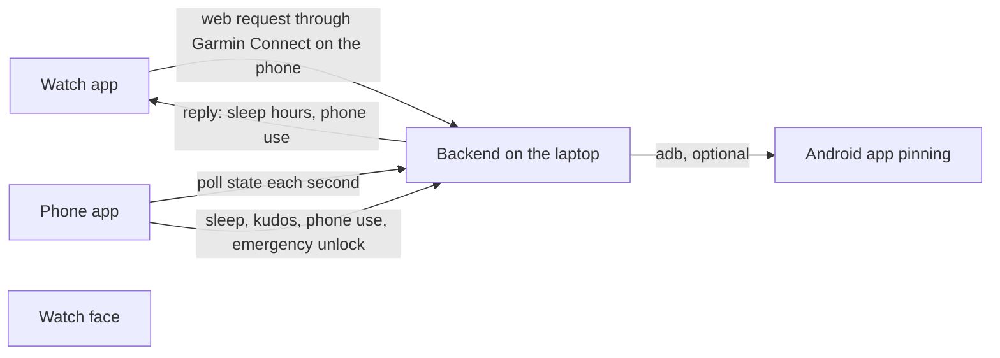

# HANDOVER: FocusPeak (Tech Thursday x Garmin hackathon, 2026-11-14)

> This file lets a new person or a new AI session continue the work with no other context. It holds
> the state, how to run each part, what was tested and how, the failure points with their fixes, the
> science, the path to an iPhone version, and the open work. Section 16 is a start prompt for another
> large language model (LLM) session.

## 0. Status at handover (tag `v7` in `main_project`, commit `cd7174d` in `focuspeak-phone`)

| Part | Folder | State | Verified how | Your open action |
|---|---|---|---|---|
| Watch app | `main_project/watch/` | ✅ Builds for `fenix7pro` and `fr265` | 17 of 17 unit tests in the simulator. Real Forerunner 265: the owner ran full demo blocks, the watch log shows each message answered with code 200 | Check the newest build on the watch (section 9.3) |
| Watch face | `main_project/watchface/` | ⚠️ Builds, on the watch | 6 of 6 unit tests. Never seen on a screen by the builder | Look at it on the watch |
| Backend | `main_project/backend/` | ✅ Runs on the laptop | 20 of 20 tests. Live with the real watch and the real phone | None |
| Phone app (React Native, Expo) | `focuspeak-phone/` | ✅ Runs in Expo Go on a Samsung A56 | 14 logic tests. Each tab and each state seen on the phone | None |
| Phone page (web prototype) | `main_project/phone/index.html` | ⚠️ Works, but older than the React Native app | Checked in a browser at tag `v5` | Use the React Native app. Keep this page as a fallback |
| Real watch to backend to phone | None | ✅ Works over USB | Watch log, backend log, phone screen | None |
| Phone use during focus lowers the score | Watch, backend, phone | ⚠️ Phone to backend to watch reply verified. The lower score on the watch screen is not yet seen on a real watch | Phone test with a 9 s exit: backend counted `exits 1, away_s 9` and sent it in the next reply to the watch | Run one block on the watch, leave the phone app, check the score line "Phone 1x -6" |
| Real phone lock (app pinning) | `backend/phone_lock.py` | ✅ Works, optional (`--pin`) | Android reported `PINNED` and `NONE` at the right states | Decide if the demo uses it |
| Always-on screen during a block | Watch | ❌ Not confirmed | The owner reported "no always-on display" before the last change. The change is untested | Section 12, item 2 |
| Pitch | `pitch/` (made by a second session) | ⚠️ Deck v1, talk notes, judge answers exist. Not reviewed in this session. They describe an older state | None | Update the deck to this state, record a fallback video, rehearse |
| iPhone app | None | ❌ Not built | None | Section 13 |

## 1. The product in one paragraph

FocusPeak is "Strava for focus". A Garmin watch app runs a focus block, scores it (Focus score, 0 to
100), and makes the user earn the phone break with the heart rate ("Move to unlock"). The phone locks
during focus and opens at the break. The app learns the best time of day, the best place and the
right block length of each user. The problem statement of the organizers: "Build something that
would make your own Health & Wellness better", with bonus points for each Garmin sensor in real use.
The judging criteria (0 to 5 each): Problem-Solution Fit, Execution and Deployment, User Experience
and Design, Impact and Value (habits), Creativity and Approach.

## 2. Where everything is

| Path | What it holds |
|---|---|
| `CLAUDE.md`, `START_HERE.md`, `MAP.md` (repo root) | Event rules, toolchain, build commands, workstream map |
| `main_project/README.md` | Short run guide and status |
| `main_project/DECISIONS.md` | One dated line per decision with its reason, and the version table |
| `main_project/PLAN_v1.html`, `PLAN_v2.html` | The approved plan: critique of the first ideas, science table, architecture |
| `main_project/watch/` | Watch app (Monkey C). `source/core/` = pure logic, `source/shell/` = devices, `source/tests/` = unit tests |
| `main_project/watchface/` | Watch face "FocusPeak Face" (separate Connect IQ app) |
| `main_project/backend/` | `server.py` (HTTP relay, journal, community), `phone_lock.py` (Android app pinning), `test_server.py` |
| `main_project/phone/` | `index.html` (web prototype), `LINK.md` (message contract and guide for a native phone app) |
| `focuspeak-phone/` | React Native app (Expo SDK 58, React Native 0.88). Own git repository |
| `research/hackathon/findings.md` | Event research: judging, Garmin direction, Connect IQ limits on the Fenix 7 Pro, with sources |
| `pitch/` | Deck v1 (`pitch_v1.pptx`, `.pdf`), `talk_notes.md`, `qa.md` |
| `.claude/skills/presentation/` | The pitch skill: story, demo plan, deck tools |
| `test_project/developer_key` | Connect IQ signing key. Never print, copy or commit it |

Both code folders are local git repositories with no remote. Tags in `main_project`: `v1` to `v7`.

## 3. Architecture



```
Watch app --web request (via Garmin Connect on the phone)--> Backend (laptop, port 8787)
Watch app <--reply: sleep hours, phone use of this block----- Backend
Phone app --poll /api/state each second, post sleep / kudos / away / unlock--> Backend
Backend --adb (optional, --pin)--> Android app pinning
Watch face: separate app, reads Body Battery and stress itself
```

| Rule | Detail |
|---|---|
| The watch works alone | With no phone and no backend each screen works. Links are menu switches, off by default |
| The watch owns the Focus score | The phone and the backend never change a score. They send inputs (sleep, phone use) |
| Locality | Sessions, places and the baseline stay in the storage of the watch. The backend gets a place label only, never coordinates. A session at "Home" is never shown to other users |
| Demo mode | A menu switch on the watch: 30 s focus, simulated heart rate, 15 s break, example baseline. It writes nothing to the real log |

### 3.1 How the real watch reaches the laptop

The watch calls `http://127.0.0.1:8787/api/msg`. A watch web request runs through the Garmin Connect
app on the paired phone, so `127.0.0.1` is the phone. `adb reverse tcp:8787 tcp:8787` forwards that
port to the laptop over the USB cable. This worked on a Samsung A56 with plain HTTP. It needs: the
watch paired in Garmin Connect, the phone on USB with USB debugging, and the backend running.

### 3.2 Message contract (source of truth: `main_project/phone/LINK.md`)

| Direction | Message | Meaning |
|---|---|---|
| Watch to backend | `{"t":"state","s":"ready"}` | Idle |
| Watch to backend | `{"t":"state","s":"focus","left_s":1440,"planned_s":1440}` | Focus started, then each 60 s |
| Watch to backend | `{"t":"state","s":"earn","hr":96,"target":104,"rest":58}` | Break gate, each 2 s |
| Watch to backend | `{"t":"state","s":"break","left_s":360,"planned_s":360,"hr":98,"rest":58,"steps":40,"ok":0}` | Break, each 5 s. `ok` = 1 when the heart rate is within 20 bpm of rest |
| Watch to backend | `{"t":"summary","score":82,"min":24,"place":"Library","streak":5,"next_min":29}` | Block saved |
| Backend to watch (reply) | `{"t":"sleep","hours":6.4,"exits":1,"away_s":9}` or `{"t":"ok","exits":0,"away_s":0}` | Sleep hours for the readiness, phone use of the running block |

The contract lives in four places. Change them together: `watch/source/core/Messages.mc`,
`backend/server.py`, `focuspeak-phone/src/logic.js`, `main_project/phone/LINK.md`.

## 4. How to build and run

### 4.1 Watch app and watch face (Git Bash)

```bash
SDK="$APPDATA/Garmin/ConnectIQ/Sdks/connectiq-sdk-win-9.1.0-2026-03-09-6a872a80b/bin"
KEY="D:/Projects/Hackathon_Tech_Thursday_x_Garmin/test_project/developer_key"
cd main_project/watch        # or main_project/watchface
"$SDK/monkeyc.bat" -f monkey.jungle -d fr265 -o bin/FocusPeak-fr265.prg -y "$KEY" -w -l 2
"$SDK/monkeyc.bat" -f monkey.jungle -d fenix7pro -o bin/FocusPeak-fenix7pro.prg -y "$KEY" -w -l 2
# unit tests (simulator open: "$SDK/connectiq.bat")
"$SDK/monkeyc.bat" -f monkey.jungle -d fenix7pro -o bin/app-test.prg -y "$KEY" -t -l 2
MSYS_NO_PATHCONV=1 "$SDK/monkeydo.bat" bin/app-test.prg fenix7pro /t
```

| Topic | Fact |
|---|---|
| SDK | 9.1.0 only (organizer rule). 9.3.0 is installed too: do not use it |
| To the watch | Copy the `.prg` into `GARMIN/Apps` over USB. The watch is a Media Transfer Protocol (MTP) device, not a drive letter |
| Watch USB mode | If Windows shows the watch as `091E:0003` with a driver error, set the watch to Settings, System, USB Mode, MTP, and replug |
| Watch log | Put an empty `FocusPeak.TXT` into `GARMIN/Apps/LOGS`. The watch then writes each `System.println` line there. Read it back over USB |
| Wearing and USB | The watch cannot run the app while it is on the cable. Copy, unplug, test, replug, read the log |

### 4.2 Backend

```bash
cd main_project/backend
python server.py            # http://127.0.0.1:8787, data saved in data.json
python server.py --fresh    # start from the example data
python server.py --pin      # also pin the Android app during focus (needs adb and USB)
python server.py --lan      # listen on the Wi-Fi too (failed on this laptop with WinError 10013)
python -m pytest test_server.py -q
```

| Route | Use |
|---|---|
| `POST /api/msg` | A watch message. The reply carries sleep hours and the phone use of the block |
| `GET /api/state` | Latest state, sequence number, last summary, phone use. The phone polls it each second |
| `GET /api/me` | Journal of the user, week, streak, best day parts, best places |
| `GET /api/leaderboard`, `/api/places`, `/api/feed`, `/api/challenge` | Community views (example friends) |
| `POST /api/sleep` `{hours}` | Sleep hours from the phone |
| `POST /api/away` `{seconds}` | The user left the phone app during focus and came back |
| `POST /api/kudos` `{id}` | Kudos on a feed item |
| `POST /api/unlock` | Emergency unlock: releases the app pin |
| `GET /` | Serves the web prototype `phone/index.html` |

### 4.3 Phone app (React Native)

```bash
cd focuspeak-phone
npm install
npx expo start --localhost --port 8081      # NOT with CI=1: that turns off file watching
adb reverse tcp:8081 tcp:8081               # Expo dev server
adb reverse tcp:8787 tcp:8787               # backend
adb shell am start -a android.intent.action.VIEW -d "exp://127.0.0.1:8081"   # opens the app in Expo Go
node src/logic.test.mjs                     # logic tests
npx expo export --platform android --output-dir dist-check   # proves the bundle compiles
```

The app looks for the backend at `http://127.0.0.1:8787` (`src/api.js`). With a backend it is in live
mode (green "LIVE" tag). Without one it uses example data and a built-in watch simulator.

## 5. The watch app in detail

### 5.1 States and screens

| State | Screen | Leaves by |
|---|---|---|
| Ready | 4 pages (UP, DOWN or swipe): Readiness, Your Best, Inputs, Settings | START (or tap) starts a block. On the Settings page START opens the menu |
| Focus | Term box "Focus", minutes left, ring. No live numbers on purpose. "Restless" hint when the wrist moves | Timer end. BACK asks "End focus now?" |
| Move to unlock | Live heart rate, target, ring. "Stairs n of 3 m" when climbing | Heart rate at or above the target for 10 s (3 s in demo), or 3 m climbed. BACK asks "Skip? Streak resets" |
| Break | Countdown, "Phone earned", live "98 bpm +40 steps" or "Recovered" | Timer end. BACK ends it |
| Summary | Focus score, streak, next block length, or "Phone 1x -6" after phone use | START, tap or BACK |

### 5.2 Rules (all in `source/core/`, each with a unit test)

| Rule | Value | File |
|---|---|---|
| Readiness | Weighted mean of the inputs that are present: Body Battery 25, calm (100 minus stress) 20, sleep 15, own hour 15, own place 10, do-not-disturb 10, temperature 5 | `Scoring.mc` |
| Focus score | Time on task 50, wrist stillness 30, calm heart rate 20. Then minus the phone penalty | `Scoring.mc` |
| Phone penalty | 5 points per exit from the phone app + 1 point per 6 s away, 30 at most | `Scoring.mc` |
| Break gate | Heart rate at or above max(100, resting + 30) bpm | `Scoring.mc` |
| Break length | Block / 4, between 5 and 15 min | `Scoring.mc` |
| Block length | Starts at 24 min. Plus 5 after 3 scores of 70 or more in a row. Minus 5 after 2 scores below 50. Range 15 to 90 | `Scoring.mc` |
| Streak | A full block on a new day adds a day. A skipped gate resets it. An early end gives a score but no streak day | `Scoring.mc` |
| Recovered | Heart rate within 20 bpm of rest | `Scoring.mc` |
| Day parts | Morning 5 to 11, afternoon 12 to 16, evening 17 to 21, night 22 to 4 | `Baseline.mc` |
| Places | One GPS fix. Same place inside 150 m. 5 places at most. Label from a list (Home, Library, Campus, Office, Cafe) | `Baseline.mc` |
| Sleep part | 4 h or less = 0, 8 h or more = 100. Only for the day the hours arrived | `Messages.mc` |

### 5.3 Sensors and their jobs

| Sensor | Job | Where |
|---|---|---|
| Heart rate | Break gate (live), calm part of the score, recovery in the break (live), Inputs page | `Sensors.mc` |
| Accelerometer | Wrist stillness: movement above 250 milli-g between two 1 s samples counts as restless | `Sensors.mc` |
| Steps (from the accelerometer) | Steps since the break began | `ActivityMonitor` |
| GPS | One fix for the place label | `Position`, one shot |
| Barometer | Metres climbed at the gate. 3 m opens it | `Sensor.Info.altitude` |
| Temperature | Difference from the user's usual value (the sensor reads warm on the wrist) | Readiness, after 3 sessions |
| Pulse Ox | Shown on the Inputs page, amber below 92 %. Runs only while that page shows | `Sensors.setPulseOx` |
| Body Battery, stress | Largest parts of the readiness | `SensorHistory`, `ActivityMonitor` |

Not used, and why: compass and gyroscope (no honest job found). Barometric pressure and Pulse Ox as
focus signals (no source supports it).

### 5.4 Files

| File | Role |
|---|---|
| `core/Scoring.mc`, `Session.mc`, `Baseline.mc`, `Messages.mc`, `Terms.mc` | Pure logic: scores, the state machine, the baseline, the messages, the shared terms |
| `shell/Sensors.mc` | The one owner of the sensors, with demo values |
| `shell/Store.mc` | Storage on the watch. In demo mode it holds example data and writes nothing |
| `shell/PhoneLink.mc` | Sends messages: "Phone link" (Connect IQ Mobile SDK, phone side not built) or "Server link" (web request) |
| `shell/Recorder.mc` | Records each block as an activity. Demo blocks are discarded |
| `FocusPeakApp.mc` | 1 s timer, wiring, save |
| `FocusView.mc`, `FocusDelegate.mc` | Screens and input (buttons and touch mapped by hand) |
| `tests/CoreTests.mc` | 17 known-answer tests |

## 6. The phone app in detail

| Tab | Content |
|---|---|
| Focus | The ring that follows the watch. Idle: next block length. Tiles: Streak, focus time this week (`h:mm`), Block. Sleep card |
| Lock view | Full screen during Focus and Move to unlock. Tab bar hidden, Android back button off, a 3 s "Emergency" hold |
| Journal | Three week numbers, a 7-day bar chart colored by score, the session list ("phone 1x" after phone use) |
| Friends | Team challenge, leaderboard with bars and a near goal ("1:13 h more and you pass Arjun"), shared places, feed with kudos |
| You | One-sentence insight, best time, best places, own recipe, "Why it works" with four sources, privacy |

| File | Role |
|---|---|
| `App.js` | Shell, tabs, live poll, built-in simulator, leave detection (`AppState`) |
| `src/logic.js` | Pure functions, no React Native import, so plain Node runs the tests |
| `src/terms.js`, `src/ui.js` | The shared terms and the `Chip` box |
| `src/api.js` | HTTP helpers and the backend address |
| `src/screens/*.js` | One file per tab |

## 7. Shared terms (the same on the wrist and on the phone)

The owner's rule: a concept must look the same on both devices, so the user recognizes it and never
guesses. Each term has one word (sentence case), one color and one pill-shaped box.

| Term | Color | Hex |
|---|---|---|
| Ready, Focus score | Neutral | `#EEF1F5` |
| Focus, Block | Blue | `#4DA3FF` |
| Move to unlock, Streak | Amber | `#FFB020` |
| Break | Green | `#3DDC84` |

Sources of truth: `watch/source/core/Terms.mc` and `focuspeak-phone/src/terms.js`. The watch uses its
built-in condensed font. The phone uses Roboto Condensed (`sans-serif-condensed`), the closest match.
They are not the same font file.

## 8. Design rules that were applied

| Rule | Where |
|---|---|
| One number per watch screen, text inside the round safe area, state in words and not only in color | Watch |
| No live numbers on the Focus screen | Watch (a moving number pulls the eye) |
| Durations as `h:mm` with an "h" label. A single block stays in minutes | Phone |
| Answer first, detail second | Journal week numbers, You insight sentence |
| Comparisons as bar lengths | Leaderboard |
| A near goal | "n min more and you pass X" |
| Touch targets at least 48 px | Kudos buttons (Google accessibility guidance) |
| Text contrast at least 4.5 to 1 | All theme colors were calculated: the lowest is 6.3 to 1 |
| App status away from the top right corner | The "LIVE" tag sits next to the app name |

## 9. Test record

### 9.1 Automated

| Suite | Result | Command |
|---|---|---|
| Watch core | 17 of 17 | Section 4.1 |
| Watch face core | 6 of 6 | Section 4.1, in `watchface/` |
| Backend | 20 of 20 | `python -m pytest test_server.py -q` |
| Phone logic | 14 groups pass | `node src/logic.test.mjs` |
| Phone bundle | Compiles | `npx expo export --platform android` |

### 9.2 Seen on real devices

| Check | Result |
|---|---|
| Real Forerunner 265, demo block with Server link | The watch log shows ready, focus, 5 heart rate updates, 3 break updates, summary, each answered with 200 |
| Phone follows the real watch | Confirmed by the owner ("now they link") |
| Phone states with the shared term boxes | Seen: Ready, Focus, Move to unlock, Break with live heart rate, Focus score |
| App pinning | Android reported `PINNED` in Focus and Move to unlock, `NONE` in Break, Ready and after the emergency hold |
| Leave detection | 9 s exit: backend counted it, the reply to the watch carried it, the journal kept it |
| Watch buttons | Work well (owner) |
| Watch simulator (Forerunner 265) | Seen: Ready with the boxes, the 4 pages, Settings page, Focus |

### 9.3 Not verified

| Item | Why |
|---|---|
| Newest watch build on the watch: touch mapping, live break line, phone penalty line, demo streak 4 to 5 | Copied to the watch at the end. Not run by anybody yet |
| Always-on screen | Change is untested |
| Watch face on a screen | Nobody reported on it |
| Real GPS place, real Pulse Ox, stairs gate | Need outdoor or stair tests |
| "Focus" activity in Garmin Connect after a real block | Not checked |
| Anything on a Fenix 7 Pro | Only the simulator. The judges use this watch |
| BACK and the menu in the simulator | The window-only click driver could not press them |
| A block that ends early: the phone penalty can be up to 60 s old | The watch posts only each 60 s during Focus |

## 10. Failure points and what fixed them

| # | Symptom | Cause | Fix or rule |
|---|---|---|---|
| 1 | The menu froze on the real watch | The app asked for a redraw each second while the menu covered the view | Redraw only when the view is visible and its content can change (`viewVisible`, `needsRedraw`) |
| 2 | Touch felt slow and wrong on the Forerunner 265 | Default gesture mapping | `onTap` and `onSwipe` mapped by hand in `FocusDelegate.mc` |
| 3 | Simulator dialog "There is no data connection ... ADB" | `Communications.transmit` in the simulator needs an Android phone on ADB | "Phone link" is a switch, off by default |
| 4 | The simulator did not reach the backend | The simulator blocks plain HTTP | Simulator menu: Settings, uncheck "Use Device HTTPS Requirements" |
| 5 | Holding UP did not open the menu in the simulator | Simulator limit | Settings page: START opens the same menu |
| 6 | Phone app: ring text not centred, lock view not full screen | `StyleSheet.absoluteFillObject` does not exist in React Native 0.88 | `FILL` constant in `src/theme.js` |
| 7 | Phone app did not show code changes | The Expo server ran with `CI=1`, which turns off file watching | Start without `CI=1` |
| 8 | Phone app stuck on "Ready" after a live reload | Fast refresh dropped the timers | Close and reopen the app |
| 9 | `python server.py` failed on `0.0.0.0` (WinError 10013) | Windows refused the bind | Default host `127.0.0.1`. `--lan` is optional |
| 10 | Windows did not show the watch (`091E:0003`, driver error) | The watch was not in MTP mode, or the cable or port | Watch: Settings, System, USB Mode, MTP. Replug |
| 11 | A screen capture caught a private window, and a key press went to another window | Capture and keys were not limited to the simulator | Capture with `PrintWindow` on the simulator window only. Send input with `PostMessage` to that window only. Never capture the desktop |
| 12 | One simulated click counted three times | The click went to nested child windows | Send it to the smallest child window only |
| 13 | A test "return to the app" did not count | The launcher intent opened the Expo Go home screen, not the app | Return with the recent-apps switch |
| 14 | Demo streak fell from 4 to 1 after a block | The example data had no last day | The example streak ends yesterday, so today adds a day |
| 15 | Summary said "0 min" for a demo block | Whole minutes rounded down | Round up |
| 16 | Monkey C: `Session` name clash | `ActivityRecording.Session` and the app class `Session` | The recorder is in its own file that does not use the app class |
| 17 | Shell here-documents failed | An apostrophe inside the text | Write patch scripts to a file, then run them |

## 11. The science behind the design (links were read as search summaries, not full texts)

| Design choice | Finding | Source |
|---|---|---|
| Move before the break | One bout of exercise improves cognition: attention effect 0.37 (standardized mean difference) | Meta-review of 30 meta-analyses, 2025, https://pubmed.ncbi.nlm.nih.gov/39883421/ |
| The app sets the breaks (24 + 6 min) | Fixed breaks gave less fatigue and more concentration than self-chosen breaks, same work done | Biwer 2023, https://pubmed.ncbi.nlm.nih.gov/36859717/ |
| Longer breaks after hard work | Short breaks raise vigor (d = 0.36) and lower fatigue (d = 0.35). Hard tasks can need more than 10 min | Albulescu 2022, https://doi.org/10.1371/journal.pone.0272460 |
| Phone out of reach | Attention scores were lower with a phone on the desk. Replications are mixed | Skowronek 2023, https://pmc.ncbi.nlm.nih.gov/articles/PMC10249922 |
| Sleep in the readiness | Short sleep lowers sustained attention (g = -0.41) | Lowe 2017, Neuroscience and Biobehavioral Reviews (page not opened) |
| Own best hour | Performance is better at the time that matches the chronotype. Results differ by task | Jankowski 2023, https://www.ncbi.nlm.nih.gov/pmc/articles/PMC9862939/ |
| Temperature | Office performance peaks near 21 to 22 °C | Seppänen 2006, https://www.osti.gov/servlets/purl/903490 |
| 90-minute limit | No source found. It is a design cap, and the pitch must say so | None |

Say "proxy" for the Focus score. The effects are small to medium: do not promise more.

## 12. Open work, in priority order

| # | Item | Detail |
|---|---|---|
| 1 | Run the newest watch build | Section 9.3, first row. One demo block with the phone app open, leave the phone app once, and read the watch log afterwards |
| 2 | Always-on screen | A Connect IQ app cannot hold an AMOLED screen on. Each block is now a recording, so the watch setting Settings, System, Display, During Activity, Always On can apply. Test it. If it fails, the watch face is the always-on surface and the app lights the screen at each phase change |
| 3 | Fenix 7 Pro | Build is ready (`FocusPeak-fenix7pro.prg`). Sideload it on a judge watch early. Check text against the round edge at 260 px |
| 4 | Pitch | Update `pitch/` to this state: shared terms, real lock, live recovery, phone-use penalty. Record a fallback video. Three timed rehearsals. Freeze code 45 minutes before |
| 5 | Fresher phone-use data during Focus | Post the focus state each 15 s when Server link is on, so an early end gets the penalty |
| 6 | Glance for the watch app | Not built: a glance error can stop the app start, and it could not be checked |
| 7 | Sleep from the health store | The phone posts the example value 6.4 h. Section 13 for the real source |
| 8 | Accounts and a real server | Friends are example data on a local server |

## 13. Path to an iPhone version

| Need | iOS way | Note |
|---|---|---|
| Talk to the watch without a server | Connect IQ Mobile SDK for iOS: `sendMessage`, `register(forAppMessages:)`. The watch side exists ("Phone link" switch, `Communications.transmit`, `registerForPhoneAppMessages`) | Watch app identifier: `fbe42636-ca59-4d56-852b-c1c53b6bc912`. Steps in `main_project/phone/LINK.md`, section 3. Not tested with a sideloaded app |
| Keep the web-request path | The watch request goes through Garmin Connect on the iPhone. iOS needs HTTPS: use a public HTTPS address for the backend and set it in `PhoneLink.mc` (`SERVER_URL`) | The USB trick with `adb reverse` is Android only |
| Real app blocking | Screen Time API: `FamilyControls` (authorization), `ManagedSettings` (shield apps), `DeviceActivity` | The development entitlement can be enabled in Xcode for a test build. Distribution needs approval from Apple |
| Leave detection | `scenePhase` in SwiftUI, or `AppState` in React Native, same rule: count exits and seconds while the watch state is focus or earn | The logic is in `focuspeak-phone/src/logic.js` (`phonePenalty`, `awayNote`) |
| Measured sleep | HealthKit, `sleepAnalysis`, samples written by Garmin Connect. Send one number to the watch: `{"t":"sleep","hours":6.4}` | Check first on the phone: Health, Sources, Connect |
| The React Native app on iOS | It runs in Expo Go on iOS over the network. The Connect IQ SDK, HealthKit and Screen Time need a native build made on a Mac | `src/terms.js` already selects a condensed iOS font |
| Sleep score, Body Battery from the cloud | Garmin Health API. Business approval, about 2 business days | Ask Garmin staff for an evaluation key |
| Training readiness score | No public path found | Not in the watch API (Connect IQ 5.2) |

Everything in `watch/source/core/` and the rules of sections 5.2 and 7 carry over unchanged.

## 14. Rules of the event and of this workspace

| Rule | Detail |
|---|---|
| SDK | Connect IQ 9.1.0, devices `fenix7pro` (judged) and `fr265` (test watch) |
| Signing key | `test_project/developer_key`. Sign each build with `-y`. Never print, copy, regenerate or commit it |
| Pitch | 3 minutes plus questions, pitching starts at 4 pm. A working demo on a real watch beats extra features |
| Honesty | Example data is always marked (DEMO on the watch, example friends on the phone). Do not present demo values as real Garmin cloud access: the judges are Garmin staff |
| Documents | Tables first, each acronym spelled out once, no em-dashes, no people named |
| Screen and input automation | Only inside the simulator window or the phone app. Never capture the desktop. Capture the phone only while the app is in front |

## 15. Code and design conventions

| Topic | Convention |
|---|---|
| Layers | Pure core (no device calls) with tests. Thin shell for devices. Views only draw |
| Names | Units in names (`hr_bpm`, `away_s`), named constants with a reason, comments say why |
| Types | Monkey C type check level 2 (`project.typecheck = 2`). No new warnings |
| Trust boundary | Each message from the phone or the backend is checked (`parseSleep`, `parsePhone`). The backend checks ranges |
| Demo mode | Each hardware input has a demo source with the same fields |
| Shortcuts | Marked `// shortcut: <limit>, <when to fix>` |

## 16. Start prompt for another LLM session

Copy this text to start a new session:

```
You continue the FocusPeak project (Garmin Connect IQ watch app + React Native phone app + Python
backend). Read these files first, in this order, before you change anything:
1. main_project/HANDOVER.md  (state, run steps, failure points, open work)
2. main_project/DECISIONS.md (each decision with its reason)
3. main_project/phone/LINK.md (message contract)
4. CLAUDE.md (toolchain and build commands)

Hard rules:
- Build with Connect IQ SDK 9.1.0 for fenix7pro and fr265. Sign with test_project/developer_key and
  never print, copy or commit that key.
- The watch owns the Focus score. Keep pure logic in watch/source/core with a unit test per rule.
- The message contract lives in four files (Messages.mc, server.py, logic.js, LINK.md): change them
  together.
- The shared terms (Ready, Focus, Move to unlock, Break, Focus score, Streak, Block) keep one word,
  one color and one box on both devices (Terms.mc and terms.js).
- Run the tests after each change: watch (17), watch face (6), backend (20), phone logic (14 groups).
- Report what is tested on a real device and what is not. Mark example data as example data.
- Never capture the desktop or send keys to a window other than the simulator.

Your first task: section 12 of HANDOVER.md, item 1.
```

## Glossary

| Short form | Full form |
|---|---|
| adb | Android Debug Bridge: the tool that talks to an Android phone over USB |
| AMOLED | active-matrix organic light-emitting diode (the Forerunner 265 display) |
| API | application programming interface |
| bpm | beats per minute |
| GPS | Global Positioning System |
| HTTP, HTTPS | Hypertext Transfer Protocol, and its secure form |
| LLM | large language model |
| MTP | Media Transfer Protocol: how Windows sees the watch storage |
| SDK | software development kit |
| USB | Universal Serial Bus |
