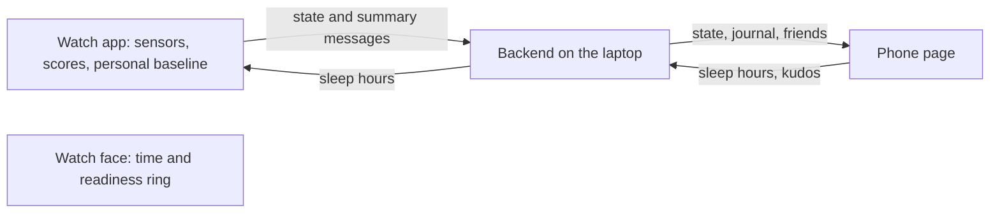

# FocusPeak

> A Garmin watch app that scores each focus session, makes the user earn each phone break with the
> heart rate, and learns when and where the user focuses best. This file says what each folder holds
> and how to run it. Decisions and versions are in `DECISIONS.md`. The full state, the failure points
> and the open work are in `HANDOVER.md`: read that file first.

## 0. Status (tag `v5`, 2026-11-14)

| Part | Folder | State | Your open action |
|---|---|---|---|
| Watch app | `watch/` | ✅ Builds for `fenix7pro` and `fr265`, 15 of 15 unit tests pass in the simulator | Copy the build to the watch and check each screen |
| Watch face | `watchface/` | ⚠️ Builds, 6 of 6 unit tests pass. Not seen on a screen | Copy it to the watch and look at it |
| Backend | `backend/` | ✅ 14 of 14 tests pass. Runs on this laptop | None |
| Phone page | `phone/index.html` | ✅ Checked in the browser with the backend | Open it on the phone |
| Watch to backend, live | None | ⚠️ Not confirmed | Run section 2 once |
| Phone link without a server | `phone/LINK.md` | ⚠️ Watch side built, phone side not built | For the phone-app team |

## 1. How the parts connect



```
Watch app --state and summary--> Backend (laptop) --state, journal, friends--> Phone page
Watch app <------sleep hours---- Backend <------------sleep hours, kudos------ Phone page
Watch face: separate app, shows the time and a readiness ring
```

The watch app works with no phone and no backend. The backend gets a place label only, never
coordinates, and a session at "Home" is never shown to other users.

## 2. Run the full demo in simulation

| Step | Do this |
|---|---|
| 1 | Start the backend from `backend/`: `python server.py` (add `--fresh` for clean example data) |
| 2 | Open `http://127.0.0.1:8787` in a browser. The tag reads "LIVE · EXAMPLE FRIENDS" |
| 3 | Start the Connect IQ simulator and load `watch/bin/FocusPeak-fenix7pro.prg` (commands in the repo `CLAUDE.md`) |
| 4 | Simulator menu: Settings, uncheck "Use Device HTTPS Requirements" |
| 5 | Watch app: DOWN three times to SETTINGS, START, turn on "Demo mode" and "Server link", BACK |
| 6 | UP three times to READINESS, then START |

| Time | Watch | Phone page |
|---|---|---|
| 0 to 30 s | FOCUS | Full-screen LOCKED |
| About 10 s | MOVE TO UNLOCK, the heart rate climbs | MOVE TO UNLOCK with the same heart rate |
| 15 s | BREAK | UNLOCKED |
| Then | FOCUS SCORE | Score, a new session in Journal and in Friends |

The phone page also runs alone: open `phone/index.html` as a file and press "Start block".

## 3. The watch app on a real watch

| Item | Value |
|---|---|
| Forerunner 265 | Copy `watch/bin/FocusPeak-fr265.prg` into `GARMIN/Apps` |
| Fenix 7 Pro | Copy `watch/bin/FocusPeak-fenix7pro.prg` into `GARMIN/Apps` |
| Buttons | START: go on. BACK: stop. UP and DOWN: pages of the Ready screen. Hold UP, or START on the Settings page: menu |
| Demo mode | 30 s focus, simulated heart rate, 15 s break, example baseline. Writes nothing to the real log |
| Phone link, Server link | Off by default. "Server link" uses `http://127.0.0.1:8787` and is made for the simulator |

## 4. Tests

| Part | Command | Result on 2026-11-14 |
|---|---|---|
| Watch core | Build with `-t`, then `monkeydo ... /t` with the simulator open | 15 of 15 |
| Watch face core | The same, in `watchface/` | 6 of 6 |
| Backend | `python -m pytest test_server.py -q` in `backend/` | 14 of 14 |

## 5. Not done, not tested

| Item | State |
|---|---|
| Any screen on a real watch after the menu fix | Not confirmed by the owner of the watch |
| Watch simulator or real watch sending to the backend | Not confirmed |
| Native phone app, real app blocking, sleep from the health store | Not built. The phone page uses the example value 6.4 h |
| Glance of the watch app | Not built |
| Friends, leaderboard, shared places | Example data on a local server, no accounts |
