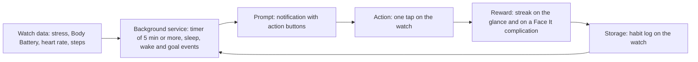

# Event research findings: Tech Thursday x Garmin hackathon (Hack West), 2026-11-13

> This file holds sourced facts and ranked guesses for the hackathon on Saturday 2026-11-14. It
> is not a team plan, and it holds no project code.

**Labels.** VERIFIED: the source page or the local vendor file states the fact. INFERRED: reasoning
from the rows that the cell names. NOT FOUND: the searches in the appendix gave no source. The word
in parentheses gives the source type. All searches and page reads occurred on 2026-11-13.

## 0. Status

| # | Question | Answer in one line | Confidence | Your open action |
|---|---|---|---|---|
| 1 | Who runs the event, and earlier editions | Tech Thursday, a Canadian tech-events company. One earlier Hack West: 2025-11-15, 8 hours, theme "Canadian productivity crisis", same prize table. No earlier Garmin hackathon found | Medium | Ask the organizers if artificial intelligence (AI) coding tools are permitted. The 2025 edition promoted them |
| 2 | Garmin hackathons and contests | Garmin judges rewarded working on-watch apps. The Garmin Health Awards judge "customer benefit, scalability, uniqueness, innovation and performance". The 2025 audience prize went to a daily-nudge company | Medium | Use these five words when you describe impact |
| 3 | Garmin in Alberta | Garmin Canada has its head office in Cochrane, with about 290 staff in Canada. Research and development (R&D) on fitness, outdoor and wireless products, and on heart rate and heart rate variability (HRV) sensors | High | None |
| 4 | Garmin habit direction | Log a behavior, then see its effect on sleep, stress and HRV: Lifestyle Logging (2025, on the watch in 2026), Health Status (2025), nutrition log (2026) | High | Do not rebuild a feature that Garmin already ships. Bring it to the wrist of the Fenix 7 Pro |
| 5 | Connect IQ on the Fenix 7 Pro | Application programming interface (API) level 5.2. Notifications with action buttons, background events, stress and Body Battery history: all available. Store review is too slow: sideload through Universal Serial Bus (USB) | High | Bring a USB cable. Do one test sideload in the first hour |
| 6 | Pitch tips | One-sentence summary early, live demo on a real watch, show the prompt, the action and the reward | Medium | Use the `presentation` skill |
| 7 | Theme guesses | 1: a daily health habit from watch data. 2: healthy work habits for productivity. 3: activity with challenges | Low (guesses) | Bring one idea for each of the top three themes |

## 1. Organizers: Tech Thursday and Hack West

### 1.1 Who runs Tech Thursday

| # | Finding | Status | Source | Page date |
|---|---|---|---|---|
| 1.1 | Tech Thursday calls itself "Canada's Home for Tech and Innovation". It connects innovators, entrepreneurs and tech leaders "through events and media" | VERIFIED (organizer) | Tech Thursday on Eventbrite, https://www.eventbrite.ca/o/tech-thursday-50372314113 | Not shown |
| 1.2 | It started "in 2022 as a Neo Financial-led initiative" for senior tech professionals. In July 2024 it "officially became an independent company" | VERIFIED (news) | calgary.tech, https://calgary.tech/2025/04/24/tech-thursday-expands-to-edmonton/ | 2025-04-24 |
| 1.3 | Events occur each week on four themes: technical deep dives, local trends, business growth and strategy, and diversity, equity and inclusion. Sessions are designed to "feel like live podcasts" | VERIFIED (news) | calgary.tech, https://calgary.tech/2025/04/24/tech-thursday-expands-to-edmonton/ | 2025-04-24 |
| 1.4 | Chapters in 2025: Calgary, Winnipeg, Ottawa (from May 2025) and Edmonton (from May 2025). The article also announced a one-time Toronto event for 2025-06-26 | VERIFIED (news) | calgary.tech, https://calgary.tech/2025/04/24/tech-thursday-expands-to-edmonton/ | 2025-04-24 |
| 1.5 | "Since launching in 2022, the organization has hosted 175+ events and welcomed more than 20,000 attendees". Calgary chapter from June 2023 | VERIFIED (news) | calgary.tech, https://calgary.tech/2026/01/08/tech-thursday-kicks-off-2026/ | 2026-01-08 |
| 1.6 | Tech Thursday won "Ecosystem Supporter of the Year" at the Start Alberta 2025 Tech Awards | VERIFIED (news) | calgary.tech, https://calgary.tech/2025/11/13/calgary-companies-stand-out-at-start-albertas-2025-tech-awards/ | 2025-11-13 |
| 1.7 | Its website lists "Cross-Canada Hackathons" among its formats. A Garmin logo shows in the section "Trusted by North America's Best in Tech" | VERIFIED (organizer) | techthursday.ca, https://techthursday.ca | Not shown |
| 1.8 | Most Calgary sessions in 2026 started at 4:30 pm on Thursdays. None of the 19 listed sessions names Garmin or a hackathon | VERIFIED (organizer) | Calgary Tech Thursday on Eventbrite, https://www.eventbrite.ca/cc/calgary-tech-thursday-2240739 | Not shown |
| 1.9 | Earlier Garmin contact: a Tech Thursday panel, "Garmin's Product Development: Meeting the Customer's Needs vs. Desires", on 2025-03-27, with Garmin product-management and engineering staff | VERIFIED (news) | Calgary Tech Journal, https://calgarytechjournal.com/p/fueling-calgary-s-future-meet-the-innovators-leading-the-way | 2025-03-26 |

### 1.2 The earlier Hack West (November 2025)

| # | Item | Finding | Status | Source | Page date |
|---|---|---|---|---|---|
| 1.10 | Name | "Solving the Canadian Productivity Crisis Hackathon with Calgary Tech Thursday" | VERIFIED (event page) | Platform Calgary, https://www.platformcalgary.com/event/solving-the-canadian-productivity-crisis-hackathon | Event date 2025-11-15 |
| 1.11 | Date and place | 2025-11-15, 9:00 am to 6:00 pm, Microsoft Canada, 110 9 Ave SW, Calgary | VERIFIED (event page) | Platform Calgary, https://www.platformcalgary.com/event/solving-the-canadian-productivity-crisis-hackathon | Event date 2025-11-15 |
| 1.12 | Second city | Winnipeg ran the same hackathon at the same time ("cross-city"), at Launch Coworking | VERIFIED (event page) | luma, Winnipeg, https://luma.com/f2bgkkwu | Not shown |
| 1.13 | Format | One full day of 8 hours, built on "Vibe Coding". Cross-functional teams of junior and senior professionals. Sign up alone or name teammates. Non-developers welcome. Ticket CA$25 | VERIFIED (event page) | luma, Calgary, https://luma.com/8zzlk12u | Not shown |
| 1.14 | Theme | Canada's productivity crisis: design and prototype next-generation business productivity solutions | VERIFIED (event page) | Platform Calgary, https://www.platformcalgary.com/event/solving-the-canadian-productivity-crisis-hackathon | Event date 2025-11-15 |
| 1.15 | Partners | Neo, Helcim, ZayZoon, Microsoft, Motiv and Robin. Garmin is not on the list | VERIFIED (event page) | luma, Calgary, https://luma.com/8zzlk12u | Not shown |
| 1.16 | Prizes | First place $1,000, second place $500, People's Choice $500 | VERIFIED (event page) | luma, Calgary, https://luma.com/8zzlk12u | Not shown |
| 1.17 | Size | The Calgary page shows 65 attendees | VERIFIED (event page) | luma, Calgary, https://luma.com/8zzlk12u | Not shown |
| 1.18 | Judging criteria | Not on the three event pages | NOT FOUND | Rows 1.10, 1.12, 1.13 | None |
| 1.19 | Winners | No winner list or recap found | NOT FOUND | Queries 6, 37, 39 | None |
| 1.20 | The name "Hack West" | A podcast episode was "recorded at the vibe coding Hack West Hackathon inside the Microsoft Calgary office", about "the country's productivity challenge" | VERIFIED (podcast page) | Code to Cloud, https://codetocloud.podbean.com/e/innovation-in-action-live-from-the-hack-west-hackathon%f0%9f%8e%99%ef%b8%8f | 2025-11-16 |
| 1.21 | Link | Hack West is the brand of the Tech Thursday hackathon. Saturday is its second known edition and the first known edition with Garmin | INFERRED | Rows 1.10, 1.11, 1.20, and the organizer post "Welcome to Hack West!" | None |
| 1.22 | An earlier Tech Thursday hackathon with Garmin | No such event found | NOT FOUND | Queries 1 to 13, 37 to 39 | None |

What this tells the team (INFERRED from rows 1.13, 1.16 and 1.20). The organizer kept the prize table
of 2025. Expect the same format: one day, mixed teams, and non-developers on the team. The 2025
theme was business productivity, and the audience is tech and business professionals.

## 2. Garmin hackathons and contests elsewhere

| # | Event and year | What Garmin asked for | What won, or what the judges valued | Status | Source | Page date |
|---|---|---|---|---|---|---|
| 2.1 | Garmin Programming Showdown, University of Nebraska-Lincoln, 2014-11-15 | Connect IQ apps for Garmin wearables, with the new software development kit (SDK). 16 participants in 9 groups | Winning apps not described. Each winner got a watch that runs the app and a $100 card | VERIFIED (university) | University of Nebraska-Lincoln newsletter, https://newsroom.unl.edu/announce/cse/3862/21672 | 2014-12-03 |
| 2.2 | Garmin IQ program for high school students, Olathe head office, 2016 | Learn Monkey C, then build a final project | Judged "by the Connect IQ team". 1st: disc golf app that measures throw distance with the Global Positioning System (GPS). 2nd: route-home app with GPS and a mapping API. 3rd: watch face that shows the sun position | VERIFIED (vendor) | Garmin blog, https://www.garmin.com/en-US/blog/fitness/garmin-iq-program/ | 2016-12-21 |
| 2.3 | Connect IQ Developer Summit awards, 2017 | Nominated store apps | Best Watch Face: Actiface, with "a highly configurable dashboard summarizing their health". Other categories: smart app, workout app, Edge app, ANT app | VERIFIED (vendor) | Garmin blog, https://www.garmin.com/en-US/blog/fitness/connect-iq-developer-summit-award-winners/ | 2017-04-21 |
| 2.4 | Connect IQ Developer Awards, 2020 | Apps of 2019 | User vote: "Garmin asked you to vote". Categories: watch face, smart app, Edge app, app for the active lifestyle | VERIFIED (vendor) | Garmin blog, https://www.garmin.com/en-US/blog/general/2020-connect-iq-developer-awards-winners/ | 2020-05-22 |
| 2.5 | Connect IQ Developer Awards, 2022 | Store apps | Best New App, Best New Watch Face, and a new Innovation Award | VERIFIED (vendor) | Garmin blog, https://www.garmin.com/en-US/blog/general/2022-connect-iq-developer-award-winners/ | 2022-11-10 |
| 2.6 | Garmin Health Awards at the Garmin Health Summit, 2025 | Established health solutions that use Garmin devices | Criteria: "customer benefit, scalability, uniqueness, innovation and performance". People's Choice: Optimity, "a Canadian-born technology company focused on creating daily nudges, challenges and rewards". Expert's Choice: Fimo Health (cancer-related fatigue). A panel discussed "how technology can drive habit change" | VERIFIED (vendor) | Garmin newsroom, https://www.garmin.com/en-US/newsroom/?p=5902 | 2025-09-19 |
| 2.7 | Garmin Health Awards, 2026, call for entries | Categories: Health Care and Research, Insurance and Employee Health ("corporate wellness-related initiatives"), Fitness and Wellness | The same five criteria. Two judging panels: experts and attendees | VERIFIED (vendor) | Garmin newsroom, https://www.garmin.com/en-PH/newsroom/press-release/news-2026-apr-health-summit-awards/ | 2026-04-24 |
| 2.8 | Garmin Health Awards, 2026, result (Bangkok, 2026-10-28 to 2026-10-29) | Six finalists | Expert's Choice: Montefiore Einstein (passive activity data in a cancer-treatment study). People's Choice: HeraMED (women's health platform). 113 entries from 31 countries | VERIFIED (news) | Selular.ID, https://selular.id/2026/10/ini-dia-pemenang-garmin-health-awards-2026-di-bangkok/ | 2026-10-31 |
| 2.9 | Cursor Hackathon at the University of Calgary (date not shown) | Theme told at the Saturday kickoff. 24-hour sprint, teams of 3 to 4 | Garmin is one of the "participating partners" | VERIFIED (event page) | luma, https://luma.com/fi3qudr1 | Not shown |
| 2.10 | Garmin internal hackathons | Not known | A search result points to a LinkedIn post on a Garmin Tacx internal hackathon. The page was not opened, so the row gives no detail | NOT FOUND | Query 22 | None |

What Garmin judges reward (INFERRED from rows 2.1 to 2.7):

| Signal | Rows |
|---|---|
| A working app on the watch that uses a watch sensor in a new way | 2.1, 2.2 |
| Health data that a user can read at a glance | 2.3 |
| Customer benefit and scale, said in those words | 2.6, 2.7 |
| Daily nudges, challenges and rewards won the audience vote in 2025 | 2.6 |

## 3. Garmin in Calgary and Alberta

| # | Finding | Status | Source | Page date |
|---|---|---|---|---|
| 3.1 | Garmin Canada has its Canadian head office in Cochrane, west of Calgary. It began in 1998 as Dynastream Innovations, "with four of us working out of a garage in Cochrane" | VERIFIED (news) | calgary.tech, https://calgary.tech/2023/02/06/garmin-canada-to-expand-in-cochrane/ | 2023-02-06 |
| 3.2 | Garmin bought the company in 2006. Cochrane became the official Canadian head office in July 2018 | VERIFIED (partner content) | Calgary Tech Journal, https://calgarytechjournal.com/p/the-tech-company-drawing-talent-to-cochrane | 2025-03-16 |
| 3.3 | About 290 employees in Canada, most in Cochrane. A third floor came in 2024 | VERIFIED (news) | CP24, https://www.cp24.com/news/money/2026/01/06/garmin-brand-continues-to-grow-with-cochrane-alta-roots/ | 2026-01-06 |
| 3.4 | The office does R&D "on fitness, outdoor, and wireless products". The ANT+ low-power wireless protocol came from this team | VERIFIED (partner content) | Calgary Tech Journal, https://calgarytechjournal.com/p/garmin-attracts-b-c-engineers-to-its-canadian-office-in-alberta | 2025-03-10 |
| 3.5 | A recent Cochrane product: the HRM 200 chest strap, which "measures ECGs and delivers real-time heart rate and HRV data" (ECG: electrocardiogram) | VERIFIED (partner content) | Calgary Tech Journal, https://calgarytechjournal.com/p/garmin-attracts-b-c-engineers-to-its-canadian-office-in-alberta | 2025-03-10 |
| 3.6 | Products named in 2026: fitness watches, bike computers, marine GPS, heart rate monitors. The Blaze horse tracker uses heart rate technology from Cochrane. A product performance team runs community product tests | VERIFIED (news) | CP24, https://www.cp24.com/news/money/2026/01/06/garmin-brand-continues-to-grow-with-cochrane-alta-roots/ | 2026-01-06 |
| 3.7 | Cochrane R&D also covers bike pedals, GPS watches, dog training devices and swim technology. An internship program takes about 20 engineering students | VERIFIED (city agency) | Calgary Economic Development, https://www.calgaryeconomicdevelopment.com/news/garmin-quality-tested-in-the-canadian-rockies/ | 2021-08-24 |
| 3.8 | Local community links: the Tech Thursday panel (1.9), the logo on the Tech Thursday website (1.7), and a partner role in a student hackathon (2.9) | VERIFIED | Rows 1.7, 1.9, 2.9 | None |
| 3.9 | Garmin staff at the event will probably come from the Cochrane sensor, fitness and wireless teams. Correct use of heart rate, HRV, stress and Body Battery data will matter to them | INFERRED | Rows 3.4 to 3.6 | None |

## 4. Garmin habit and health direction (dated)

| # | Date | Feature | What it does | Fenix 7 Pro | Status | Source | Page date |
|---|---|---|---|---|---|---|---|
| 4.1 | 2023 launch | Fenix 7 Pro health set | Body Battery, sleep score, morning report, HRV status, training readiness, Pulse Ox, jet lag adviser, light-emitting diode (LED) flashlight | Yes | VERIFIED (vendor) | Garmin Singapore, https://www.garmin.com.sg/news/press-release/news-2023-jul-epix-fenix7/ | 2023-06-28 |
| 4.2 | March 2025 | Garmin Connect+ (paid plan) | Active Intelligence: "personalized insights and suggestions throughout the day based on health and activity data, powered by AI". Also badge challenges. "All existing features and data in Garmin Connect will remain free" | Phone app | VERIFIED (vendor) | Garmin Singapore, https://www.garmin.com.sg/news/press-release/news-2025-apr-garmin-connect/ | 2025-03-28 |
| 4.3 | September 2025 | Lifestyle Logging and Health Status (Venu 4 launch) | Log preset or custom behaviors, "like caffeine and alcohol consumption". Reports show the effect on sleep, stress and HRV. Health Status (beta) flags sleep-time heart rate, HRV, respiration and skin temperature that move away from the usual range | Phone app (row 4.4) | VERIFIED (vendor) | Garmin newsroom, https://www.garmin.com/en-US/newsroom/?p=5877 | 2025-09-17 |
| 4.4 | September 2025 | Lifestyle Logging details | Free: "There is no Connect+ required here." Five categories plus custom behaviors. First report after about four weeks. The Fenix 7 family gets Health Status in the phone app only, with no widget on the watch | Phone app only | VERIFIED (review) | dcrainmaker.com, https://www.dcrainmaker.com/2025/09/lifestyle-logging-journaling-health-status-vs-whoop-everything.html | 2025-09-18 |
| 4.5 | November 2025 | Health Status on more watches | On the watch and in the app for Venu X1, vivoactive 6, Fenix 8, Forerunner 570 and 970 | Not named | VERIFIED (vendor) | Garmin newsroom, https://www.garmin.com/en-US/newsroom/?p=5984 | 2025-11-18 |
| 4.6 | January 2026 | Nutrition tracking (Connect+) | Food log, barcode scan, AI photo log. Insights "can encourage users to adjust their habits" | Not named | VERIFIED (vendor) | Garmin newsroom, https://www.garmin.com/en-PH/newsroom/press-release/news-2026-jan-garmin-connect/ | 2026-01-05 |
| 4.7 | February 2026 | Lifestyle Logging on the watch, and sleep alignment | Users "log behaviors" such as caffeine and alcohol "on their watch". Sleep alignment shows how close the user is to the circadian rhythm | Not named. Named: Venu X1, vivoactive 6, Fenix 8 Pro, Forerunner 570 and 970, "and more" | VERIFIED (vendor) | Garmin newsroom, https://www.garmin.com/en-US/newsroom/?p=6112 | 2026-02-24 |
| 4.8 | July 2026 | CIRQA smart band | The "first screen-free smart band" from Garmin, "no subscription required". Body Battery, sleep score, sleep stages, HRV, training readiness | Not applicable | VERIFIED (vendor) | Garmin newsroom, https://www.garmin.com/en-PH/newsroom/press-release/news-2026-jul-cirqa/ | 2026-07-27 |
| 4.9 | August 2026 | Fenix 9 series | "Garmin Epic" turns many activities "into one cohesive story in Garmin Connect" | Not applicable | VERIFIED (vendor) | Garmin newsroom, https://www.garmin.com/en-US/newsroom/press-release/outdoor/garmin-expands-its-flagship-performance-smartwatch-lineup-with-fenix9-and-fenix9-pro/ | 2026-08-25 |
| 4.10 | August 2026 | Fenix 9 lifestyle logging glance | "Use the lifestyle logging glance on your fēnix® watch to discover how everyday behaviors affect several health metrics" | Not applicable | VERIFIED (vendor manual) | Fenix 9 manual, https://www8.garmin.com/manuals/webhelp/GUID-708A8F4D-9A78-49CF-9528-DE109BBCC472/EN-US/GUID-756C5C3F-7C01-4F14-9565-3AD04C2C865A.html | Revision August 2026 |
| 4.11 | 2022 and later | Badge challenges | Monthly opt-in challenges in Garmin Connect, for example "record 300,000 steps in May" | Phone app | VERIFIED (vendor) | Garmin blog, https://www.garmin.com/en-US/blog/general/may-monthly-garmin-connect-badge-challenges-2/ | 2022-04-28 |
| 4.12 | 2025 manual | Hydration tracking glance | "displays your fluid intake and your daily hydration goal". Alerts are optional | Not examined | VERIFIED (vendor manual, Venu Sq 2) | Venu Sq 2 manual, https://www8.garmin.com/manuals/webhelp/GUID-C3225F6F-DF15-4404-9E20-05C4FDCD1207/EN-US/GUID-976C04FF-A4A4-4925-AA4F-34E44C4D468A.html | Revision May 2025 |
| 4.13 | 2026 | Can a Connect IQ app write Lifestyle Logging entries? | One forum reply: "No to all the questions." No Garmin statement | Not applicable | VERIFIED (forum, weak) | Garmin forum, https://forums.garmin.com/developer/connect-iq/f/discussion/436912/can-connect-iq-apps-write-caffeine-entries-to-garmin-connect-lifestyle-logging | About 5 months before 2026-11-13 |

What this tells the team (INFERRED from rows 4.3 to 4.10). Garmin links a logged behavior to sleep,
stress and HRV, and then gives an insight. Most of this lives in the phone app and on watches from
2025 and 2026. The Fenix 7 Pro gets Health Status only in the phone app (row 4.4). The sources do not
name it for logging on the watch (row 4.7). A Connect IQ app can bring a fast log, a timely nudge and
a streak to the wrist of a Fenix 7 Pro.

## 5. Connect IQ facts for the Fenix 7 Pro with SDK 9.1.0

**Source note.** Rows marked "SDK doc" come from the copy that ships with SDK 9.1.0, at
`%APPDATA%\Garmin\ConnectIQ\Sdks\connectiq-sdk-win-9.1.0-2026-03-09-6a872a80b\doc\`. The URL in
the row is the same page on developer.garmin.com. The fetch tool saw only the navigation of the online
core-topic pages, so this file does not compare the online text. Rows marked "device file" come from
`%APPDATA%\Garmin\ConnectIQ\Devices\fenix7pro\`.

### 5.1 The device

| # | Finding | Status | Source | Page date |
|---|---|---|---|---|
| 5.1 | API level 5.2 for all five Fenix 7 Pro models (7 Pro, 7S Pro, 7X Pro, and the two Solar Editions without Wi-Fi). Fenix 8 47 mm is at 6.0 | VERIFIED (vendor) | Compatible devices, https://developer.garmin.com/connect-iq/compatible-devices/ | Not shown |
| 5.2 | Device file: `connectIQVersion` 5.2.0, firmware 2316, group "API level 5.2" | VERIFIED (device file) | `fenix7pro\compiler.json` | Downloaded 2026-11-12 |
| 5.3 | Screen: round, 260 x 260 pixels, memory-in-pixel (MIP), touch. The 7S Pro is 240 x 240 and the 7X Pro is 280 x 280. Flashlight colors: white and red | VERIFIED (device file) | `fenix7pro\compiler.json` and `simulator.json` | Downloaded 2026-11-12 |
| 5.4 | Memory limits: device app 768 KB, data field 256 KB, watch face 128 KB, glance 64 KB, background service 64 KB (KB: kilobyte) | VERIFIED (device file) | `fenix7pro\compiler.json` | Downloaded 2026-11-12 |
| 5.5 | The device file has no separate widget app type. A forum reply: "'widget' isn't a valid app type for devices with CIQ 4 or greater." Build a device app with a glance | VERIFIED (device file, forum) | Garmin forum, https://forums.garmin.com/developer/connect-iq/f/discussion/380299/sideload-old-widget-on-fenix-7/1813790 | More than 2 years before 2026-11-13 |
| 5.6 | Connect IQ 9 (API 6.0) does not come to this watch: "The Forerunner 965, Fenix 7 Pro, Venu 3, and Instinct 3 do not." | VERIFIED (news) | the5krunner, https://the5krunner.com/2026/06/11/garmin-connect-iq-9/ | 2026-06-11 |
| 5.7 | The simulator file holds heart rate history every 60 s (360 samples) and Pulse Ox every hour. It lists no stress or Body Battery history | VERIFIED (device file) | `fenix7pro\simulator.json` | Downloaded 2026-11-12 |
| 5.8 | The simulator can give empty stress and Body Battery history. Plan a demo mode with recorded values | INFERRED | Row 5.7 | None |

### 5.2 App types for a habit app

| App type | Use in a habit app | Limits | Status | Source |
|---|---|---|---|---|
| Device app with a glance | Primary choice: full API, a glance in the glance list, own menus | Glance memory 64 KB. From API 4.0.0, apps "must implement a glance view to appear in the glance list" | VERIFIED (SDK doc) | Glances, https://developer.garmin.com/connect-iq/core-topics/glances/ |
| Background service | Timed or event checks, then a notification | Timer events not closer than 5 minutes. The service stops after 30 s without `Background.exit()`. All background code must have the `(:background)` annotation | VERIFIED (SDK doc) | Backgrounding, https://developer.garmin.com/connect-iq/core-topics/backgrounding/ |
| Watch face | A streak that the user always sees | No Attention module (no vibration). No web requests in the foreground, but its background service can make them. In sleep mode, one update each minute | VERIFIED (SDK doc) | App Types, https://developer.garmin.com/connect-iq/connect-iq-basics/app-types/ |
| Data field | Only inside an activity | Web requests only from API 5.0.0 | VERIFIED (SDK doc) | App Types, https://developer.garmin.com/connect-iq/connect-iq-basics/app-types/ |
| Complication publisher | A device app can publish up to four complications. Face It watch faces can show them. The device file lists Face It templates for the Fenix 7 Pro | Necessary permission: `ComplicationPublisher`. Only watch faces subscribe | VERIFIED (SDK doc, device file) | Complications, https://developer.garmin.com/connect-iq/core-topics/complications/ |
| Notifications in each app type | The App Types table marks Notifications for all five app types | API 5.1.0, Notifications permission | VERIFIED (SDK doc) | App Types, https://developer.garmin.com/connect-iq/connect-iq-basics/app-types/ |

### 5.3 Health data that an app can read on the Fenix 7 Pro

| API | Data | From API | On Fenix 7 Pro | Permission | Status | Source |
|---|---|---|---|---|---|---|
| `SensorHistory.getStressHistory()` | Stress samples on the device | 3.3.0 | Yes | SensorHistory | VERIFIED (vendor) | SensorHistory, https://developer.garmin.com/connect-iq/api-docs/Toybox/SensorHistory.html |
| `SensorHistory.getBodyBatteryHistory()` | Body Battery samples | 3.3.0 | Yes | SensorHistory | VERIFIED (vendor) | SensorHistory, https://developer.garmin.com/connect-iq/api-docs/Toybox/SensorHistory.html |
| `SensorHistory.getHeartRateHistory()` | Heart rate samples | 2.1.0 | Yes | SensorHistory | VERIFIED (vendor) | SensorHistory, https://developer.garmin.com/connect-iq/api-docs/Toybox/SensorHistory.html |
| `SensorHistory.getOxygenSaturationHistory()` | Pulse Ox, only if the user turned on Pulse Ox recording | 3.2.0 | Yes | SensorHistory | VERIFIED (vendor) | SensorHistory, https://developer.garmin.com/connect-iq/api-docs/Toybox/SensorHistory.html |
| SensorHistory limits | Device data only: "This does not have access to synced data." Also: "There are no guarantees on the sample interval" | Not applicable | Not applicable | Not applicable | VERIFIED (SDK doc) | Quantifying the User, https://developer.garmin.com/connect-iq/core-topics/quantifying-the-user/ |
| `ActivityMonitor.getInfo()` | Steps, step goal, calories, distance, floors, active minutes (day, week, week goal), move bar level, sleep-mode flag, respiration rate, stress score of the last 30 s (API 5.0.0), time to recovery | 1.0.0 | Yes | None | VERIFIED (SDK doc) | Quantifying the User, https://developer.garmin.com/connect-iq/core-topics/quantifying-the-user/ |
| `ActivityMonitor.getHistory()` | Daily history: "a seven day history is fairly typical" | 1.0.0 | Yes | None | VERIFIED (SDK doc) | Quantifying the User, https://developer.garmin.com/connect-iq/core-topics/quantifying-the-user/ |
| `UserProfile.getProfile()` | Sleep time and wake time as the user set them, resting heart rate, 7-day average resting heart rate, VO2 max, height, weight, birth year | 1.0.0 | Yes | UserProfile | VERIFIED (SDK doc) | Quantifying the User, https://developer.garmin.com/connect-iq/core-topics/quantifying-the-user/ |
| `Sensor.registerSensorDataListener()` with `HeartRateData.heartBeatIntervals` | Beat-to-beat intervals while the app runs. A team can calculate a live HRV-style value for a breathing exercise (INFERRED use) | 2.3.0 and 3.0.0 | Yes | Sensor | VERIFIED (SDK doc) | `doc\Toybox\Sensor\HeartRateData.html` in SDK 9.1.0 |
| Not in SDK 9.1.0 | No API for sleep score, sleep stages, HRV status, Health Status, hydration or Lifestyle Logging | Not applicable | Not applicable | Not applicable | VERIFIED (scoped search) | Text search of all pages in `doc\Toybox` for "sleep score", "sleepScore", "sleep stage", "HRV", "heart rate variability" and "hydration": 0 files |

### 5.4 Nudges, timing, storage and settings

| Topic | Finding | Status | Source |
|---|---|---|---|
| Notifications | `Notifications.showNotification(title, subTitle, options)` with a body, an icon, action buttons (`:actions`) and `:dismissPrevious`. `registerForNotificationMessages()` reports "dismissed" or "selected". API 5.1.0, Fenix 7 Pro on the supported list, and the device API file holds `showNotification` | VERIFIED (vendor, device file) | Notifications, https://developer.garmin.com/connect-iq/api-docs/Toybox/Notifications.html |
| Notification from the background | The SDK sample calls `showNotification()` from a background `onTemporalEvent()`, with four action buttons | VERIFIED (SDK sample) | `samples\Notifications\source\BackgroundDelegate.mc` in SDK 9.1.0 |
| Action data | "If the user selects one of these actions, the state dictionary of your AppBase.onStart() is called with :launchedFromNotification containing the action data" | VERIFIED (SDK doc) | Notifications, https://developer.garmin.com/connect-iq/core-topics/notifications/ |
| Wake request | `Background.requestApplicationWake(message)` asks the user to open the app. Device apps and widgets only. Message up to 255 bytes | VERIFIED (SDK doc) | Notifications, https://developer.garmin.com/connect-iq/core-topics/notifications/ |
| Attention | `vibrate()`, `playTone()`, `backlight()` and `setFlashlightMode()` (API 3.4.3) list the Fenix 7 Pro. Watch faces cannot use them | VERIFIED (SDK doc) | Getting the Users Attention, https://developer.garmin.com/connect-iq/core-topics/getting-the-users-attention/ |
| Toast | `WatchUi.showToast()` (API 3.4.0) lists the Fenix 7 Pro | VERIFIED (SDK doc) | `doc\Toybox\WatchUi.html` in SDK 9.1.0 |
| Background events | Timer: a Moment or a Duration, not less than 5 minutes after the last event, one timer at a time. Also: goal met, sleep time, wake time, every 1,000 steps, activity completed, phone app message | VERIFIED (SDK doc) | Backgrounding, https://developer.garmin.com/connect-iq/core-topics/backgrounding/ |
| Simulator | The Simulation menu can start a background service by hand | VERIFIED (SDK doc) | Backgrounding, https://developer.garmin.com/connect-iq/core-topics/backgrounding/ |
| Storage | `Application.Storage` keeps key-value data on the watch. Background access from API 3.2.0. The guide says 8 KB for each key and value and 128 KB in total. The API reference says values up to 32 KB and a limit that changes by device. Plan for the smaller numbers | VERIFIED (two vendor statements disagree) | Persisting Data, https://developer.garmin.com/connect-iq/core-topics/persisting-data/ |
| Settings | Users change settings in the Connect IQ Store app, Garmin Connect or Garmin Express. `onSettingsChanged()` runs after a change. The simulator has a settings editor | VERIFIED (SDK doc) | Properties and App Settings, https://developer.garmin.com/connect-iq/core-topics/properties-and-app-settings/ |
| Settings after a sideload | Forum: "You can't use app settings with a sideload." Garmin, on a bug report (2020-04-17): beta and pending apps "cannot be referenced or found by GCM", "Working as intended" | VERIFIED (forum) | Garmin forum, https://forums.garmin.com/developer/connect-iq/i/bug-reports/no-settings-for-pending-application-in-connect-mobile-app |
| Web requests | `Communications.makeWebRequest()` sends JavaScript Object Notation (JSON) requests through Garmin Connect Mobile on the phone, or through Wi-Fi. The callback is asynchronous. Communications permission | VERIFIED (SDK doc) | HTTPS, https://developer.garmin.com/connect-iq/core-topics/https/ |

What this tells the team (INFERRED from the rows above). Put the demo settings in a menu on the watch,
because the phone app cannot change the settings of a sideloaded app. A web request works only with a
paired phone that runs Garmin Connect, and with a network at the venue. Keep a path that works without
the phone.

### 5.5 Not available on the Fenix 7 Pro (SDK 9.1.0)

| Group | APIs | Reason | Status |
|---|---|---|---|
| API 6.0 | `ScanCode.createQrCodeImage()` (quick response (QR) codes on the watch), `Communications.registerForPhoneAppMessageErrors()`, `UserProfile.Profile.upcomingSleepTime` and `upcomingWakeTime` | Above API 5.2. The device API file holds no `createQrCodeImage` | VERIFIED (SDK doc, device file) |
| API 5.2.2 | `UserProfile.getHeartRateZones2()`, `getPowerZones()`, `getFunctionalThresholdPower()`, `getCurrentSport2()`, `Activity.SplitInfo`, `DataField.onTimerSplitStart()` and the related split calls | The watch is at 5.2.0. The device API file holds no `getHeartRateZones2` | VERIFIED (SDK doc, device file) |
| Watch face extras | `Application.WatchFaceConfig` (settings edited on the watch), `WatchFaceDelegate.onTap()` and `getComplicationDrawable()` | Fenix 7 Pro not on the supported list | VERIFIED (SDK doc) |
| App state calls | `AppBase.onActive()`, `onInactive()`, `isActive()`, `getGlanceTheme()`, `onNightModeChanged()`, `onDisplayModeChanged()`, `System.getDisplayMode()` | Fenix 7 Pro not on the supported list | VERIFIED (SDK doc) |
| Menus and views | Menu icons (`Menu2.setIcon()`, `MenuItem.setIcon()`), menu dividers, `View.setControlBar()`, action menus (`onActionMenu()`), `NumberPicker`, `WatchUi.getSubscreen()` | Fenix 7 Pro not on the supported list | VERIFIED (SDK doc) |
| Other | Wheelchair push fields, control of ANT+ fitness equipment, `PersistedContent` tracks | Fenix 7 Pro not on the supported list | VERIFIED (SDK doc) |

**Method.** A script read every page in `doc\Toybox` of SDK 9.1.0 (1,411 module, class and method
blocks). It listed each block whose "Supported Devices" list leaves out "fēnix® 7 Pro". It also listed
each block whose `Since` level is above 5.2.0.

### 5.6 Ways to deploy for the judges

| Path | How | Time | Who can install | Can a judge test it? | Status | Source |
|---|---|---|---|---|---|---|
| Sideload through USB | Build for `fenix7pro`. "Copy the generated PRG files to your device's GARMIN/APPS directory" (PRG: the program file) | Minutes | A watch that you connect with a cable | Yes: give the judge the watch | VERIFIED (SDK doc) | Your First App, https://developer.garmin.com/connect-iq/connect-iq-basics/your-first-app/ |
| Sideload limits | Forum: "PRGs built for other devices are no longer accepted". The `ciq_log` file in `/garmin/apps/logs` shows load errors | Not applicable | Not applicable | Not applicable | VERIFIED (forum) | Garmin forum, https://forums.garmin.com/developer/connect-iq/f/discussion/380299/sideload-old-widget-on-fenix-7 |
| Simulator | Run the program file in the Connect IQ simulator on a laptop | Minutes | The laptop | Yes, on the laptop | VERIFIED (SDK doc) | Your First App, https://developer.garmin.com/connect-iq/connect-iq-basics/your-first-app/ |
| Beta app | Upload with a second app identifier. "URLs to the beta will not be visible outside of your account" | Upload in minutes | Only the account that uploaded it | Only on a watch paired to that account | VERIFIED (SDK doc) | Beta Apps, https://developer.garmin.com/connect-iq/core-topics/beta-apps/ |
| Beta install at this time | On apps.garmin.com, "the download button is gone". Open the app link from the old developer dashboard on the phone, with the same account | Not applicable | The uploader | No | VERIFIED (forum) | Garmin forum, https://forums.garmin.com/developer/connect-iq/f/discussion/428418/installing-beta-versions/2005561 |
| Share a beta | Forum: "Neither is possible" | Not applicable | Not applicable | No | VERIFIED (forum) | Garmin forum, https://forums.garmin.com/developer/connect-iq/f/discussion/323796/is-it-possible-to-share-a-beta-app-for-testing-to-multiple-accounts-or-people |
| Public store | "Aside from special circumstances, such as national holidays, reviews are completed within 72 hours." While pending, only the developer can download it | 72 hours or more | Each user after approval | Not on 2026-11-14 | VERIFIED (SDK doc) | Publishing to the Store, https://developer.garmin.com/connect-iq/core-topics/publishing-to-the-store/ |
| Store delay in October 2026 | "expect it up to two weeks late, and Garmin has given no date for that to improve" | Up to two weeks | Not applicable | No | VERIFIED (news, page dated 2026-10-16, updated 2026-10-30) | the5krunner, https://the5krunner.com/2026/10/16/connect-iq-store-delays/ |
| Private or unlisted store link | No such option found | Not applicable | Not applicable | Not applicable | NOT FOUND | Queries 14 to 16 |
| Own data from the Garmin cloud | Garmin Connect Developer Program, "Personal" tier: "Log in to the Garmin Connect website to retrieve your personal API key". "Pull only". Activity, Health and Women's Health data | Set-up time unknown | The account owner | Only through a companion web page | VERIFIED (vendor) | Garmin Connect Developer Program, https://developer.garmin.com/gc-developer-program/overview/ |

What this tells the team (INFERRED from the table). The primary demo is a sideloaded app on a watch
that a judge can hold. The second option is the simulator on a laptop. Do not plan on the store.

### 5.7 A habit loop that the Fenix 7 Pro can run (INFERRED design)



```
Watch data (stress, Body Battery, heart rate, steps)
  -> Background service (timer of 5 min or more, sleep, wake and goal events)
  -> Prompt (notification with action buttons)
  -> Action (one tap on the watch)
  -> Reward (streak on the glance and on a Face It complication)
  -> Storage (habit log on the watch) -> back to the background service
```

Each box uses an API from sections 5.2 to 5.4. This design is a suggestion. Nobody has built or tested it.

## 6. Pitch tips

| # | Tip | Status | Source | Page date |
|---|---|---|---|---|
| 6.1 | Say what the product does in one clear sentence near the start. "A common error is to avoid describing what you do until far into the presentation." | VERIFIED (accelerator guide) | Y Combinator, https://www.ycombinator.com/blog/guide-to-demo-day-pitches/ | 2016-07-25 |
| 6.2 | One message on each slide: "A slide should have one main point, never more." | VERIFIED (accelerator guide) | Y Combinator, https://www.ycombinator.com/blog/guide-to-demo-day-pitches/ | 2016-07-25 |
| 6.3 | The same guide says videos "are almost never a good idea", because the audience wants to see you "perform live". This event scores a "live deployment we can test". Show the app live on the watch, and keep a video only as a fallback | VERIFIED (guide) and INFERRED (the advice for this event) | Y Combinator, https://www.ycombinator.com/blog/guide-to-demo-day-pitches/ | 2016-07-25 |
| 6.4 | Judges see many teams fast. The Major League Hacking (MLH) plan gives "2 minutes for presentation + demo" for each team. MLH wants demo videos to be "a demo of their hack, not a presentation" | VERIFIED (organizer guide) | MLH Judging Plan, https://guide.mlh.com/general-information/judging-and-submissions/judging-plan | 2026 season |
| 6.5 | Show the habit loop in one picture. The B=MAP model: "Behavior happens when Motivation, Ability, and a Prompt come together at the same time." Prompt: a well-timed watch notification. Ability: one tap. Motivation: a streak or an insight | VERIFIED (model site) and INFERRED (the mapping) | Behavior Model, https://behaviormodel.org/ | Not shown |
| 6.6 | Describe impact with the five words of the Garmin health judges: customer benefit, scalability, uniqueness, innovation, performance | VERIFIED (vendor) and INFERRED (the use) | Garmin newsroom, https://www.garmin.com/en-US/newsroom/?p=5902 | 2025-09-19 |

## 7. Likely problem-statement themes (ranked)

| Rank | Theme | Evidence (rows) | What to prepare | Confidence |
|---|---|---|---|---|
| 1 | A better daily health habit from the watch's own data: sleep routine, stress and recovery, movement breaks | The judges ask about "impacting people's habits" (organizer). Garmin links logged behavior to sleep, stress and HRV (4.3, 4.7, 4.10). Daily nudges won the 2025 audience vote (2.6). Cochrane works on heart rate and HRV (3.5). The Fenix 7 Pro gives stress, Body Battery and heart rate history, and notifications with buttons (5.3, 5.4) | A device app with a glance: a background check, a notification with one-tap actions, a streak, and a demo mode | Medium |
| 2 | Healthy work habits that also help productivity: breaks, focus time, stress at work, less sitting | The 2025 Hack West theme was the Canadian productivity crisis (1.14). The audience is tech and business professionals (1.1, 1.3). The Garmin Health Awards have an Insurance and Employee Health category with "corporate wellness-related initiatives" (2.7) | The same loop with work-day timing: move bar level, stress score, wake and sleep times | Low to medium |
| 3 | Regular physical activity with challenges, streaks or team rewards | Badge challenges (4.11), Connect+ badge challenges (4.2), and the "challenges and rewards" of the 2025 audience winner (2.6). Activity goals and goal-met background events (5.3, 5.4) | A weekly active-minutes goal, a goal event, a streak and a small team challenge | Low to medium |
| 4 | Outdoor and adventure habits on a rugged watch: preparation, safety check-ins, light and recovery | The Fenix 7 Pro is an outdoor watch with a white and red flashlight (4.1, 5.3). Cochrane R&D covers outdoor products (3.4) | The flashlight as a cue (red light for a wind-down routine) and time to recovery | Low |
| 5 | Calm technology habits with fewer distractions | CIRQA is the "first screen-free smart band" from Garmin (4.8) | Short silent prompts, a vibration pattern and few screens | Low |
| 6 | Nutrition and hydration habits | Nutrition logging (4.6) and a hydration glance (4.12) exist. No Connect IQ API reads these logs (5.3) | A one-tap log on the watch that the app keeps itself | Low |

## 8. Not found, excluded, and access limits

| Item | Searched | Result |
|---|---|---|
| Judging criteria and winners of Hack West 2025 | Queries 6, 37, 39 and the three event pages | Not found |
| An earlier Tech Thursday hackathon with Garmin | Queries 1 to 13 | Not found |
| A public page for the 2026 Garmin edition | Queries 11, 13, 38 | Not found |
| Garmin internal hackathon details | Query 22 | LinkedIn result not opened. Excluded |
| Garmin tracks at HackKU or Hack Midwest | Query 41 | Search summaries only. Not opened. Excluded |
| Lifestyle Logging on the Fenix 7 Pro watch | Rows 4.4 and 4.7 | Not named in the sources. Not known |
| Sleep coach on the Fenix 7 Pro | Row 4.1 source | Not in the release text |
| A private or unlisted Connect IQ Store link | Queries 14 to 16 | Not found |

| Source | Outcome | Effect on this file |
|---|---|---|
| cochrane.garmin.com press-kit Portable Document Format (PDF) file | Hypertext Transfer Protocol (HTTP) error 503 | Rows 3.1 to 3.7 use news pages instead |
| medium.com post on a Krakow hackathon with a Garmin prize | HTTP error 403 | Excluded |
| developer.garmin.com core-topic pages | The fetch tool saw navigation only | Text read in the SDK 9.1.0 local copy |
| handyai.substack.com post on a vibe-coding prize | Paywall | Not used |
| MLH blog post on judging (2014) | Redirects ended in error 404 | Not used |
| calgarytechjournal.com Garmin articles | Marked "Partner Content" | Treat rows 3.2, 3.4 and 3.5 as company-supplied text |

## Appendix A. Query log

All queries used the web search tool in standard mode on 2026-11-13. "Kept" names the pages that
this file cites. The search tool gives a summary, so this research opened each cited page on its own.

| # | Query | Kept |
|---|---|---|
| 1 | "Tech Thursday" Garmin hackathon Calgary | luma Calgary, Platform Calgary event |
| 2 | "Hack West" hackathon Calgary Platform Calgary | Code to Cloud podcast |
| 3 | "Tech Thursday" Calgary tech community hackathon | Eventbrite organizer page, calgary.tech 2025-04-24 |
| 4 | Garmin office Calgary Alberta engineering | Calgary Tech Journal (two pages) |
| 5 | "Hack West" Tech Thursday hackathon | None (other events with similar names) |
| 6 | "Tech Thursday" hackathon winners "productivity" Calgary Winnipeg 2025 | calgary.tech 2025-11-13 |
| 7 | "Garmin's Product Development" "Tech Thursday" | None |
| 8 | techthursday.ca hackathon Garmin 2026 | None |
| 9 | eventbrite "Garmin's Product Development" Meeting the Customer's Needs vs. Desires | None |
| 10 | "Tech Thursday" Garmin Cochrane panel Calgary | Calgary Tech Journal 2025-03-26, calgary.tech 2026-01-08, calgary.tech 2023-02-06 |
| 11 | luma Tech Thursday Garmin hackathon Platform Calgary November 2026 | luma Cursor Hackathon page |
| 12 | "Garmin" hackathon Calgary 2026 Connect IQ "Fenix 7 Pro" | the5krunner 2026-06-11 |
| 13 | "Hack West" 2026 hackathon Garmin | Garmin Health Awards 2026 finalists |
| 14 | forums.garmin.com connect iq beta app share with other users testers download | Forum threads 323796 and 428418 |
| 15 | forums.garmin.com sideload prg app settings Garmin Connect mobile not available sideloaded | Forum thread 7917, bug report on settings |
| 16 | forums.garmin.com Connect IQ store app review time how long approval 2025 2026 | the5krunner 2026-10-16 |
| 17 | forums.garmin.com news-announcements "Connect IQ" System 9 SDK 9.1.0 released | None (SDK date from the local folder name) |
| 18 | Garmin sponsored hackathon challenge Connect IQ winners devpost | University of Nebraska-Lincoln, Garmin IQ program, award pages |
| 19 | CalgaryHacks Garmin sponsor challenge | None |
| 20 | HackKU Garmin challenge prize track | None |
| 21 | Garmin Health Awards winners 2025 Expert's Choice People's Choice solution | Garmin newsroom 2025-09-19 |
| 22 | "Garmin" "hackathon" internal engineers winning project wearable | None (LinkedIn not opened) |
| 23 | Garmin Cluj hackathon OR "Garmin Taiwan" hackathon OR "Garmin Würzburg" hackathon | None |
| 24 | Garmin Health Summit 2026 Bangkok winners press release Montefiore HeraMED | Selular.ID 2026-10-31 |
| 25 | Garmin Cochrane job "Biosensor" OR "wellness" OR "health" software engineer Cochrane Alberta Garmin careers | None |
| 26 | Garmin Connect+ launch press release Active Intelligence March 2025 newsroom | Garmin Singapore 2025-03-28 |
| 27 | Garmin Connect "lifestyle logging" caffeine alcohol sleep HRV feature announcement | dcrainmaker.com, forum thread 436912, Fenix 9 manual page |
| 28 | Garmin Venu 4 press release September 2025 Health Status lifestyle logging newsroom | Garmin newsroom 2025-09-17 |
| 29 | Garmin Connect new feature 2026 habits OR "behavior" OR "nudge" announcement | Garmin newsroom 2026-01-05 |
| 30 | Garmin newsroom October 2026 OR November 2026 health wellness feature launch | Garmin newsroom 2025-11-18 and 2026-02-24, CIRQA 2026-07-27 |
| 31 | Garmin fenix 7 Pro launch press release May 2023 newsroom features sleep coach HRV status | Garmin Singapore 2023-06-28 |
| 32 | Garmin Connect hydration tracking widget log water intake watch support page | Venu Sq 2 manual page |
| 33 | fēnix 7 Pro owner's manual "Move Alert" OR "Hydration Tracking" OR "Relax Reminders" www8.garmin.com | None (the manual home page lists top-level topics only) |
| 34 | Devpost blog how to present a successful hackathon demo tips | None |
| 35 | MLH guide hackathon demo judging tips live demo backup video | MLH Judging Plan |
| 36 | Y Combinator library how to pitch your company demo day clear one sentence | Y Combinator guide 2016-07-25 |
| 37 | "Hack West" Calgary November 2025 hackathon winners first place team built | None |
| 38 | "Tech Thursday" "Hack West" Garmin | None |
| 39 | Tech Thursday productivity hackathon recap winner vibe coding Microsoft Calgary Winnipeg November 15 2025 | None |
| 40 | devpost "Garmin" challenge OR prize "Connect IQ" hackathon project watch app | None |
| 41 | "Hack Midwest" OR "HackKU" OR "Hack K-State" Garmin sponsor challenge winners | None (not opened) |
| 42 | Garmin "Connect IQ" "App Challenge" 2020 winners theme forum announcement | Garmin blog 2020-05-22 |
| 43 | "Garmin Canada" hackathon OR "hack" Cochrane students engineering challenge sponsor | CP24 2026-01-06, Calgary Economic Development 2021-08-24 |
| 44 | forums.garmin.com fenix 7 MTP sideload prg GARMIN APPS folder Windows copy | Forum thread 380299 |
| 45 | Garmin fēnix 9 announced 2026 press release features lifestyle logging | Garmin newsroom 2026-08-25 |

This research also opened these pages without a query:

- techthursday.ca, with its empty `/hackathon` and `/hackwest` pages
- the Connect IQ basics page, for page addresses
- the 2019 award post on the Garmin forum
- the Garmin Connect Developer Program overview

Local files that this research read:

- the SDK 9.1.0 guides in `doc\docs\` and the API pages in `doc\Toybox\`
- the `Notifications` sample of the SDK
- `compiler.json`, `simulator.json` and `fenix7pro.api.debug.xml` in the `fenix7pro` device folder

## Glossary

| Short form | Full form |
|---|---|
| AI | artificial intelligence |
| API | application programming interface |
| ECG | electrocardiogram |
| GPS | Global Positioning System |
| HRV | heart rate variability |
| HTTP | Hypertext Transfer Protocol |
| JSON | JavaScript Object Notation |
| KB | kilobyte |
| LED | light-emitting diode |
| MIP | memory-in-pixel (a reflective display) |
| MLH | Major League Hacking |
| PDF | Portable Document Format |
| PRG | program file that the watch runs |
| QR | quick response (a two-dimensional code) |
| R&D | research and development |
| SDK | software development kit |
| USB | Universal Serial Bus |
