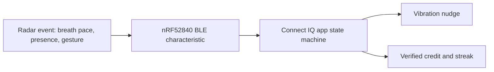

# BGT60TR13C radar: public datasets, models and habit ideas

> This file lists the public data and code for the Infineon XENSIV BGT60TR13C 60 GHz radar
> family, and gives 7 hackathon ideas that join the radar to a Garmin watch app. Every row has a
> link that was opened on 2026-11-13.

## 0. Status

| Item | Result | Your open action |
|---|---|---|
| Public BGT60TR13C datasets | ✅ 4 gesture datasets exist. Only 2 download without login | Pick the gesture data only if the idea needs a trained gesture model |
| Vital signs, presence, sleep, fall, people counting datasets for BGT60 | ❌ None public. Activity and gait data exist, but access is on request or not released | Plan to record your own short data, or use signal processing without training |
| Infineon example models and libraries | ✅ Gesture, presence, people counting and DEEPCRAFT examples are on GitHub (Infineon licence) | Confirm the kit name on the boards (`KIT_CSK_BGT60TR13C` assumed) |
| Sample download | ⚠️ Not done | No BGT60 dataset is both under 50 MB and openly licensed |
| Hackathon ideas | ✅ 7 ideas, 3 rated High | Select one idea at the event |


```
Public data or Infineon library -> BGT60TR13C radar kit -> (UART or SPI) -> nRF52840 DK
  -> (Bluetooth Low Energy) -> Garmin watch app -> nudge, timer, streak
```

## 1. Datasets recorded with the BGT60TR13C

All radars here are frequency-modulated continuous wave (FMCW) radars. "Login" means an account
or a subscription is necessary before the download.

| # | Dataset and link | What was recorded | Subjects and samples | Radar configuration | Format and size | Licence | Download without login |
|---|---|---|---|---|---|---|---|
| D1 | Frame-Labeled 60 GHz FMCW Radar Gesture Dataset, [zenodo.org/records/15178095](https://zenodo.org/records/15178095) (`10.5281/zenodo.15178095`) | 5 hand gestures (swipe left, right, up, down, push), plus anomalous fast, slow and wrist gestures, in 6 rooms (meeting room, office, library, kitchen, gym, bedroom). One label for each frame | 12 people (8 of them also made anomalous gestures). 25,000 nominal plus 24,000 anomalous recordings | 58.5 to 62.5 GHz, 32 chirps, 64 samples for each chirp, 3 virtual antennas, 33 Hz frame rate, 100 frames for each recording, 1.2 m maximum range | `.npz` (keys `inputs`, `targets`). One file `radar_dataset.zip`, 36.5 GB in the file table (the description says about 48.1 GB) | CC BY 4.0 | ✅ Yes (record marked "Open") |
| D2 | 60 GHz FMCW Radar Gesture Dataset, [ieee-dataport.org/documents/60-ghz-fmcw-radar-gesture-dataset](https://ieee-dataport.org/documents/60-ghz-fmcw-radar-gesture-dataset) (`10.21227/s12w-cc46`) | The same recordings as D1, with one label for each recording | 21,000 gestures (original), extended to 25,000 nominal plus 24,000 anomalous | Same as D1. Array shape 100 x 3 x 32 x 64 | `.npy`. `fulldata_zipped.zip` 15.06 GB and `fullextended_data.zip` 19.17 GB (the page also gives 48.1 GB and 46.8 GB) | CC BY 4.0 | ❌ No, IEEE DataPort subscription. Use D1 instead |
| D3 | Multi-Configuration FMCW Radar Dataset for Hand Gesture Recognition, [ieee-dataport.org/documents/multi-configuration-radar-dataset-hand-gesture-recognition](https://ieee-dataport.org/documents/multi-configuration-radar-dataset-hand-gesture-recognition) (`10.21227/s70p-w854`) | The 5 gestures of D2, recorded with 24 radar configurations on 3 physical sensors | 72,000 samples (72 files of 1,000). Subjects not reported | 24 configurations in `radar_configurations.csv`, 3 virtual antennas, 32 frames in each sample | `.npz`. `cl_dataset.zip` 31.21 GB | CC BY 4.0 | ❌ No, IEEE DataPort subscription |
| D4 | A Flexible Data Set for Radar-based Gesture Recognition with an FC-FMCW Radar, [radar.kit.edu/radar/en/dataset/hCNNxXlJBdFTSYse](https://radar.kit.edu/radar/en/dataset/hCNNxXlJBdFTSYse) (`10.35097/hCNNxXlJBdFTSYse`) | 7 hand gestures plus a zero class (no movement or random movement). Gesture names not reported on the page | 25 people, 2,479 recordings | Not reported on the page | One archive, 14.7 GB. Format not reported | CC BY 4.0 | ✅ Probably yes (published record, no login stated) |

### 1.1 Related data that is not public now

| Item and link | What it holds | Access |
|---|---|---|
| Cross-subject human activity recognition, [github.com/emirabayer/radar-har-bgt60tr13c](https://github.com/emirabayer/radar-har-bgt60tr13c) | BGT60TR13C, 17 subjects, about 60 clips each, 6 activities (jump, run, sit-stand, squat, stand still, walk). One tracked target for each frame at about 50 Hz | ❌ Code only (MIT). The README says the dataset "is not yet publicly available" |
| Gait monitoring, [github.com/yoginathganditi/Infineon-radar-gait](https://github.com/yoginathganditi/Infineon-radar-gait) | BGT60TR13C, 61 to 63 GHz, 12.9 frames/s, 5 gait styles in a corridor | ❌ Raw `.dat` files on request only. Code has no licence file |
| BGT60TR13C digital signal processing demo, [github.com/Havok-Alwin/BGT60TR13C-Infineon-mmwave-radar-DSP](https://github.com/Havok-Alwin/BGT60TR13C-Infineon-mmwave-radar-DSP) | 2 recordings of one person (static at about 30 degrees, and walking), `.mat` files of 5.0 MB and 3.3 MB | ⚠️ Downloadable, but no licence. Not downloaded |
| Macro and micro gestures with spiking neural networks, [arxiv.org/abs/2405.19351](https://arxiv.org/abs/2405.19351) | 60 GHz Infineon radar gesture work | ❌ No data link on the page |
| Gesture Recognition for FMCW Radar on the Edge, [arxiv.org/abs/2310.08876](https://arxiv.org/abs/2310.08876) | 5 gestures, recurrent neural network on an Arm Cortex-M4 in less than 280 kB flash and 120 kB RAM | ❌ No data or code link on the page |
| KI-ASIC Dataset, [zenodo.org/records/7838189](https://zenodo.org/records/7838189) | Car scenes with 3 Infineon radars. The page does not name the chip | Not useful for habits. 18.1 GB, CC BY-NC-SA 4.0 |

### 1.2 Searches that found no public BGT60 dataset

| Topic | BGT60TR13C | BGT60UTR11AIP | BGT60TR24 / BGT60ATR24C |
|---|---|---|---|
| Respiration and heart rate | ❌ Code only (section 2) | ❌ Code only | ❌ |
| Presence and occupancy | ❌ | ❌ | ❌ |
| Sleep | ❌ | ❌ | ❌ |
| Fall detection | ❌ | ❌ | ❌ |
| People counting | ❌ Library only (section 3) | ❌ | ❌ |
| Keystroke and micro gestures | ❌ (silent speech code in section 2) | ❌ | ❌ |

Search places: the Zenodo API, the GitHub repository search, IEEE DataPort, Kaggle and general web
search. The Zenodo query `BGT60TR13C` gives exactly 2 records: D1 and one code record.

### 1.3 Proxy vital-signs data (other radar, not BGT60)

| Dataset and link | What it holds | Licence |
|---|---|---|
| Medical radar signal dataset, [data.mendeley.com/datasets/6rp6wrd2pr/2](https://data.mendeley.com/datasets/6rp6wrd2pr/2) (`10.17632/6rp6wrd2pr.2`) | 24 GHz and 10 GHz continuous-wave radar, 9 subjects, 10 min at 1000 Hz, with respiration belt and electrocardiogram (ECG) reference. `.lvm` and `.csv` | CC BY 4.0 |

Use this only to test a breathing-rate algorithm offline. The radar type is different, so the signal levels do not transfer.

## 2. Open-source code for the BGT60 family

| Repository and link | What it does | Licence | Use for us |
|---|---|---|---|
| [github.com/finnox-tech/ifx_demo](https://github.com/finnox-tech/ifx_demo) | Python: heart rate and respiration rate from BGT60TR13C phase (range FFT, phase unwrap, band-pass filters, peak count) | GPL-3.0 | ✅ Template for a breathing-rate pipeline on a PC |
| [github.com/tqliang/Radar_Health_Monitor](https://github.com/tqliang/Radar_Health_Monitor) | C on ESP32-S3: breathing and heart rate on the microcontroller. 128 samples, 16 chirps, 3 receive antennas, about 5 Hz frames | None | ⚠️ Read for the radar settings. No licence to copy code |
| [github.com/dreamc0d/VitaRay](https://github.com/dreamc0d/VitaRay) | Heart and breathing rate with BGT60TR13C (README only, 2 kB) | None | ❌ Empty |
| [github.com/shuchi-seki/JVP-signal-processing-with-60GHz-radar](https://github.com/shuchi-seki/JVP-signal-processing-with-60GHz-radar) | Jugular venous pulse processing with BGT60TR13C. Zenodo `10.5281/zenodo.15395287` lists CC BY 4.0 | CC BY 4.0 (Zenodo) | ⚠️ Research code |
| [github.com/4uf04eG/FMCW-gesture-recognition](https://github.com/4uf04eG/FMCW-gesture-recognition) | Convolutional plus long short-term memory (CNN + LSTM) gesture model, pretrained on Deep Soli, fine-tuned on 350 own BGT60TR13C samples (data not included). Real-time script | None | ⚠️ Read for the model shape |
| [github.com/jelie-05/Radar-Gesture-Recognition](https://github.com/jelie-05/Radar-Gesture-Recognition) | Data collection, labelling and training for up, down, hold gestures. Range-Doppler projection input. Controls a game | None | ⚠️ Read for the data collection script |
| [github.com/ajisrawi/subvocal-radar](https://github.com/ajisrawi/subvocal-radar) | BGT60TR13C plus RP2040 USB dongle that reads jaw and lip motion of silent speech | None | 💡 Proof that micro skin motion is visible |
| [github.com/michaeladeleke2/SensDSv2](https://github.com/michaeladeleke2/SensDSv2) and [sensds-web](https://github.com/michaeladeleke2/sensds-web) | Live micro-Doppler spectrogram and gesture teaching tool (Python, and a browser over Web Serial) | None | ✅ Fast live view for the demo |
| [github.com/RutronikSystemSolutions/RDK2_RAB3_Radar_Sensing](https://github.com/RutronikSystemSolutions/RDK2_RAB3_Radar_Sensing) | Presence detection and person counting on BGT60TR13C (built on `xensiv-radar-sensing`) | Not stated | ⚠️ Example of the counting API |
| [github.com/RutronikSystemSolutions/NRF52840_BGT60UTR11AIP](https://github.com/RutronikSystemSolutions/NRF52840_BGT60UTR11AIP) | BGT60UTR11AIP on an nRF52840-DK over SPI (pins P1.12 to P1.15, IRQ P1.05, RST P1.07, LDO enable P1.08). Files `prj.conf` and `nrf52840dk_nrf52840.overlay` (Zephyr form) | None | ✅ Closest bridge reference for our nRF52840-DK |
| [github.com/ThinkTransit/zepyr_BGT60UTR11AIP](https://github.com/ThinkTransit/zepyr_BGT60UTR11AIP) | Zephyr register read and write test on an nRF5340-DK | None | ⚠️ SPI bring-up check |
| [github.com/Infineon/sensor-xensiv-bgt60trxx](https://github.com/Infineon/sensor-xensiv-bgt60trxx) | Infineon low-level driver for the BGT60TRxx family | Apache-2.0 | ✅ Port to Zephyr if the nRF52840 drives the radar directly |

## 3. Infineon example models and libraries

All are on GitHub and are already in `hardware/bgt60tr13c/code/`. The Infineon licences are
end-user licence agreements (EULA), not open-source licences.

| Repository and link | What it gives | Data | Target board |
|---|---|---|---|
| [Infineon/xensiv-radar-gestures](https://github.com/Infineon/xensiv-radar-gestures) | Prebuilt neural-network library: push, swipe up, down, left, right, at 0.2 to 1.0 m, detection in less than 1 s, confidence for each class | Not included | PSoC 6 (static library) |
| [Infineon/mtb-example-psoc6-radar-gestures](https://github.com/Infineon/mtb-example-psoc6-radar-gestures) | Ready application for the gesture library | Not included | `CYSBSYSKIT-DEV-01` (the board of the connected sensor kit) and `KIT-BGT60TR13C-EMBEDD` |
| [Infineon/xensiv-radar-presence](https://github.com/Infineon/xensiv-radar-presence) and [mtb-example-psoc6-radar-presence](https://github.com/Infineon/mtb-example-psoc6-radar-presence) | Presence detection of macro and micro movement, with range limits and thresholds. No training | None needed | PSoC 6 |
| [Infineon/xensiv-radar-sensing](https://github.com/Infineon/xensiv-radar-sensing) and [mtb-example-sensors-radar-entrancecounter](https://github.com/Infineon/mtb-example-sensors-radar-entrancecounter) | Presence detection and entrance counter (people counting) events | None needed | PSoC 6 |
| [Infineon/mtb-example-ml-deepcraft-deploy-radar](https://github.com/Infineon/mtb-example-ml-deepcraft-deploy-radar) | DEEPCRAFT Studio model for push and circle gestures. Drop-in `model.c/h` | Not included | `CY8CKIT-062S2-AI` only |
| [Infineon/mtb-example-ml-deepcraft-streaming-protocol](https://github.com/Infineon/mtb-example-ml-deepcraft-streaming-protocol) | Streams radar data to DEEPCRAFT Studio to record and label your own data | You make it | `CY8CKIT-062S2-AI` |
| Gesture Detection Ready Model, [imagimob.com/gesture-detection-ready-model](https://imagimob.com/gesture-detection-ready-model) | 5 gestures, more than 92 % detected at 10 to 70 cm. Hex file for test | Not stated | `CY8CKIT-062S2-AI` or the XENSIV kit |
| DEEPCRAFT Studio Accelerators, [imagimob.com/starter-models](https://imagimob.com/starter-models) | Free open models with data, but none for radar (audio, inertial, capacitive only) | ❌ No radar accelerator | Not applicable |

## 4. Hackathon ideas: radar plus watch for a daily habit

Every idea uses the same chain: the radar kit computes an event, the nRF52840-DK sends the event
over Bluetooth Low Energy (BLE), and the Connect IQ app on the watch acts. The Connect IQ SDK 9.1.0
lists `ActivityMonitor.Info.respirationRate` (API level 3.3.0) for the Fenix 7 Pro and the
Forerunner 265, so the watch can give a second breathing value.

| # | Habit | What the radar senses | What the watch does | Data or model to start | One-day feasibility | Main risk |
|---|---|---|---|---|---|---|
| 1 | **Daily 2-minute breathing break**, verified | Chest motion at a fixed range bin (phase over time). Breaths per minute and pace match | Guides slow breathing (for example 6 breaths/min) with vibration. Gives credit only when the radar confirms the pace. Shows a streak. Compares with `respirationRate` | `ifx_demo` pipeline (GPL-3.0) and Infineon presence micro-motion. No training | **High** | Body motion hides the breathing signal. Keep the user seated at 0.5 to 1 m |
| 2 | **Break up long sitting at the desk** | Presence (macro and micro) at the desk chair. Absence for at least 2 min counts as a real break | Nudges after 45 min of continuous presence. Credits the break only when the radar sees an empty chair. Daily "sit blocks" chart | Infineon `xensiv-radar-presence`. No training | **High** | The BLE bridge from the kit to the nRF52840. Have a fake event source ready |
| 3 | **Log a glass of water without a phone** | A push gesture near the water bottle | One gesture adds one glass. A ring fills on the watch. A nudge when the count is behind the clock | Infineon `xensiv-radar-gestures` (push). D1 if you retrain | **High** | False gestures from normal desk motion. Ask for a 2-gesture pattern (push, then swipe) |
| 4 | **Keep a healthy screen distance** | Distance of the torso from the monitor (static distance example `mtb-example-ce241721`) | Taps the wrist after 2 min closer than the set limit. Posture score at the end of the day | Infineon static distance example. No training | **Medium** | The torso distance is not the eye distance. Needs a short calibration |
| 5 | **20-second hand wash** | Hand motion energy in a 10 to 40 cm zone below a radar at the sink | Starts a 20 s timer by itself, buzzes at the end, and counts washes for each day | Short own recording with the DEEPCRAFT streaming example. D1 and D4 "zero class" for no-motion samples | **Medium** | Water and metal reflections. A demo needs a sink or a mock bowl |
| 6 | **Bedtime wind-down** | Person in bed and breathing becomes slow and regular | Starts a wind-down screen at the target time, logs "in bed on time" as a streak, gives a morning summary | Presence library plus the breathing pipeline of idea 1 | **Low** | Cannot show a full night live. Use recorded or fake data for the demo |
| 7 | **Mindful eating pace** | Hand-to-mouth movements per minute at the table | Vibrates when the pace is too fast. Gives a "minutes for each meal" trend | No public data. Record your own (about 30 min of labelled motion) | **Low** | Training data in one day. Classes are similar to other arm motion |

### 4.1 Top 3 for the event

| Rank | Idea | Why |
|---|---|---|
| 1 | Idea 1, breathing break verified by radar | Strong habit story (stress), the watch and the radar check each other, no training needed, works seated in front of judges |
| 2 | Idea 2, sitting breaks at the desk | Infineon presence library runs as delivered. The habit is clear and measurable. Simple demo: sit, stand up, see the credit |
| 3 | Idea 3, hands-free water log | The gesture library runs as delivered on the kit board. A visible and fun demo. Can join idea 2 as a "desk coach" |



```
radar event -> nRF52840 BLE characteristic -> Connect IQ app state machine -> nudge / verified credit and streak
```

## 5. Limits

| Limit | Effect |
|---|---|
| D1 is 36.5 GB in one zip file | Do not download it at the event. Use the Infineon gesture library instead |
| No public BGT60 data for vital signs, presence or sleep | Ideas 1, 2, 4 and 6 use signal processing or Infineon libraries, not a trained model |
| Infineon libraries run on PSoC 6, not on the nRF52840 | The kit board computes the event. The nRF52840 only relays it, or the team ports the driver |
| Kit name not confirmed on the boards | The gesture example supports `CYSBSYSKIT-DEV-01`. The DEEPCRAFT examples need `CY8CKIT-062S2-AI` |
| Some sizes conflict on the source pages (D1, D2) | The table gives both values |

## 6. Glossary

| Term | Meaning |
|---|---|
| ADC | Analog-to-digital converter: turns the radar signal into numbers |
| BLE | Bluetooth Low Energy |
| Chirp | One short frequency sweep of the radar. A frame holds many chirps |
| CNN | Convolutional neural network |
| DEEPCRAFT Studio | Infineon (Imagimob) tool to record data, train and export small models |
| ECG | Electrocardiogram: electrical heart signal, used as a reference |
| EULA | End-user licence agreement |
| FFT | Fast Fourier transform: turns a signal over time into frequencies |
| FMCW | Frequency-modulated continuous wave: a radar that sweeps its frequency to measure distance |
| LSTM | Long short-term memory: a neural network for sequences |
| Micro-Doppler | Small frequency shifts from small motions such as fingers or breathing |
| PSoC 6 | Infineon microcontroller on the radar kit boards |
| Range bin | One distance step in the radar output |
| SPI | Serial Peripheral Interface: the wired link between the radar and a microcontroller |
| UART | Universal asynchronous receiver-transmitter: a simple serial link |
